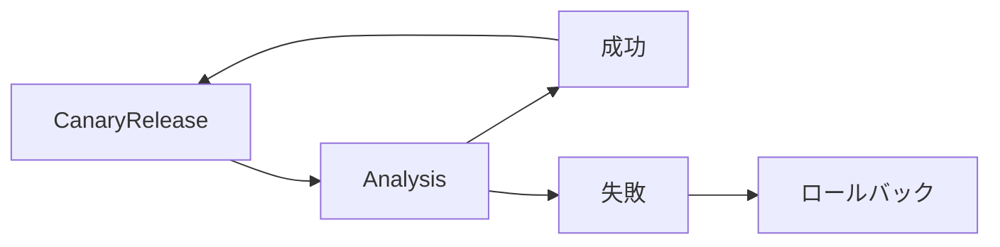
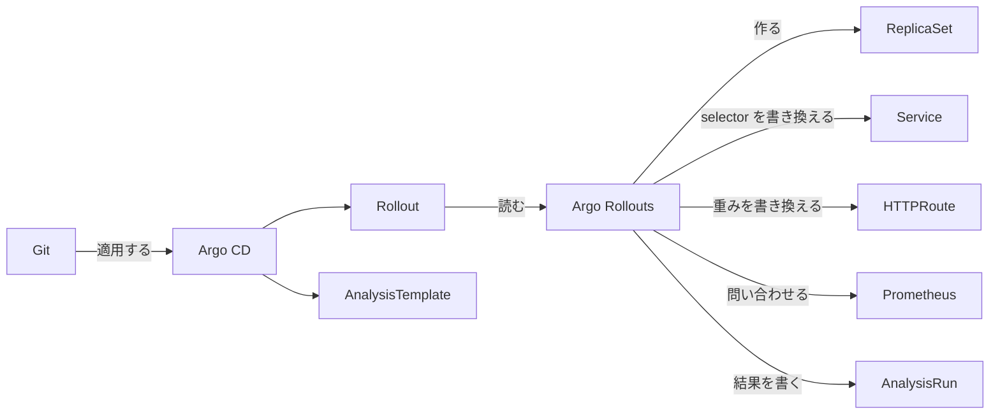
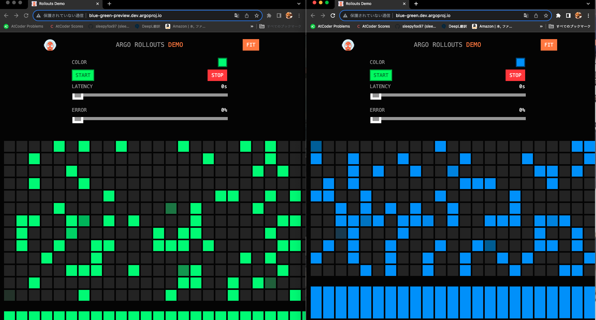
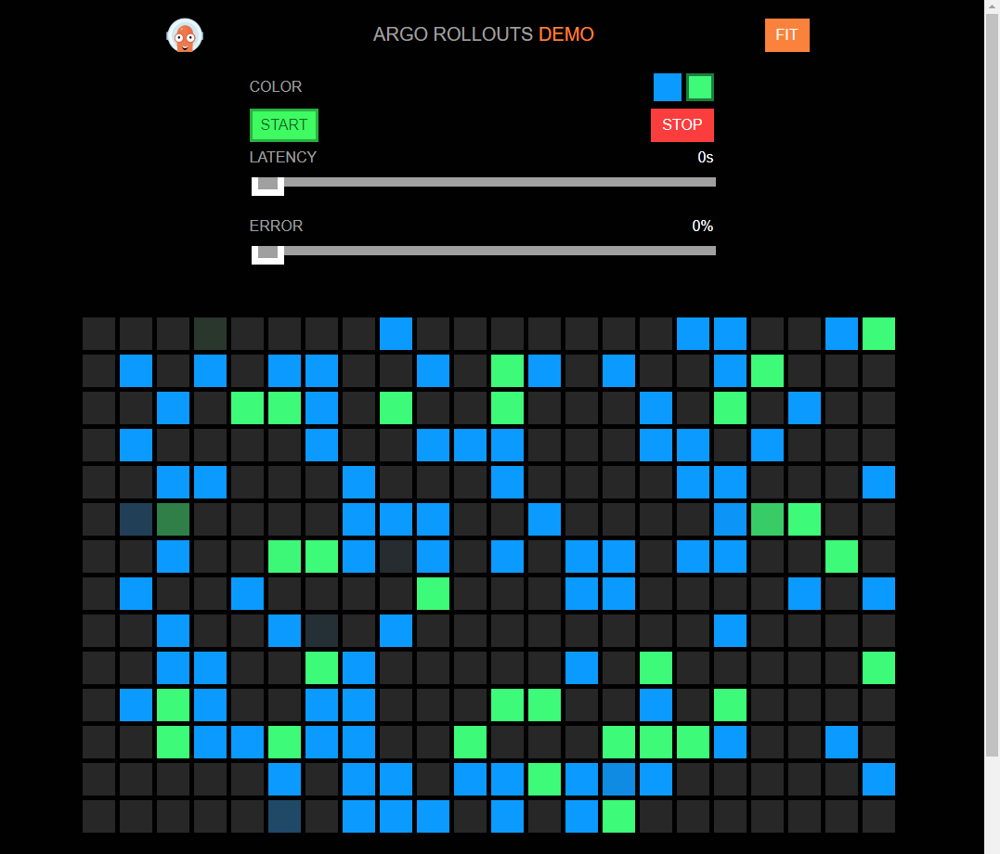

# Argo Rollouts

この章では、Kubernetes でプログレッシブデリバリーを行うツール、Argo Rollouts を使います。機能を一通り触るより、Argo Rollouts が裏で何を書き換えているかを、自分の目で確かめることを目指します。

リリースを先に進める役は、節を追うごとに人から Argo Rollouts へ移ります。Argo CD の章で、手で同期してから自動の同期に進んだのと同じ流れです。

| 節 | 先に進めるのは | 確かめること |
|---|---|---|
| Blue/Green Deployment | 人が切り替える | Pod を用意することと、トラフィックを切り替えることは、別々に起きる |
| Canary Release | 途中で止まり、人が進める | リリースが進むと、Argo Rollouts が HTTPRoute の重みを書き換える |
| Analysis | メトリクスが決める | 人がクリックしなくても、リリースが進む |
| 失敗する例 | メトリクスが止める | アプリが起動していても、エラーが多ければリリースは止まる |

## プログレッシブデリバリー

プログレッシブデリバリーは、新しいバージョンを少しずつ公開し、問題があれば自動で戻すリリースの方法です。まずトラフィックの一部だけを新しいバージョンに流し、その間にエラー率などを測ります。結果が良ければ割合を増やし、悪ければ元のバージョンに戻します。この「測って決める」部分を、Argo Rollouts では Analysis と呼びます。



Deployment のローリングアップデートは、readiness probe が通れば、Pod を新しいバージョンに入れ替えていきます。エラーを返すバージョンでも、起動さえすれば利用者の全員に届きます。プログレッシブデリバリーでは、新しいバージョンに届くのは一部のリクエストだけです。問題が見つかれば、全員に届く前に元のバージョンへ自動で戻ります。

## 誰が何を書き換えるか

この章には、Argo CD と Argo Rollouts の 2 つのコントローラーが出てきます。どちらも Kubernetes のリソースを書き換えますが、受け持ちが違います。



Argo CD は、Git に書いたマニフェストをそのままクラスターに適用します。仕事はそこまでで、リリースをどう進めるかは知りません。

Argo Rollouts は、Rollout の `strategy` を読んで、リリースを進めます。新しいバージョンの ReplicaSet を作り、Service の selector や HTTPRoute の重みを書き換えて、トラフィックの行き先を変えます。Analysis が要るときは、Argo Rollouts 自身が Prometheus などに問い合わせ、その結果で先に進むか戻すかを決めます。測った結果は、AnalysisRun に記録します。

| リソース | 書く人 | 役割 |
|---|---|---|
| Rollout | Git（Argo CD が適用） | Deployment の代わり。更新のしかたを `strategy` に書く |
| AnalysisTemplate | Git（Argo CD が適用） | 何をどう測って成功とするか |
| AnalysisRun | Argo Rollouts | AnalysisTemplate を元に、Argo Rollouts が測った結果の記録 |
| Service、HTTPRoute | Git が元で、Argo Rollouts が書き換える | トラフィックの行き先 |

以降の節では、Argo Rollouts が書き換える Service と HTTPRoute を、リリースの前後で見比べます。

## 準備

### Prometheus

Analysis で Envoy Gateway のメトリクスを使います。[chapter_prometheus](../chapter_prometheus/README.md) の手順で kube-prometheus-stack を入れます。そのうえで、Envoy Gateway のメトリクスを集める PodMonitor を作ります。

```bash
kubectl apply -f ../chapter_prometheus/manifests/envoy-gateway-podmonitor.yaml
```

### Argo CD

[chapter_argocd](../chapter_argocd/README.md) の「準備」を終えます。fork を作り、`GITHUB_USER` を設定し、Argo CD を入れた状態から始めます。

Argo CD の章の [helm/values.yaml](../chapter_argocd/helm/values.yaml) には、rollout-extension が入っています。rollout-extension は、Rollout の状態を Argo CD の Web UI に表示する拡張機能です。

この章のディレクトリに移ります。

```bash
cd ~/cnd-handson/chapter_argo-rollouts
```

### Argo Rollouts のインストール

helmfile で Argo Rollouts を入れます。

```bash
helmfile sync -f helm/helmfile.yaml
```

```bash
kubectl -n argo-rollouts get deployments
```

```
# 実行結果
NAME            READY   UP-TO-DATE   AVAILABLE   AGE
argo-rollouts   2/2     2            2           60s
```

[helm/values.yaml](helm/values.yaml) では、Gateway API のプラグインを読み込みます。Canary Release で、Rollout が HTTPRoute の重みを書き換えるのに使います。

## Blue/Green Deployment: Pod の用意と切り替えは別

Blue/Green Deployment では、新しいバージョンの Pod をすべて用意してから、トラフィックを一度に切り替えます。Deployment では、Pod の入れ替えとトラフィックの切り替えが同時に進みます。Argo Rollouts では、この 2 つが別々に起きます。

[app/blue-green/rollout.yaml](app/blue-green/rollout.yaml) の `strategy` に、2 つの Service を書きます。

```yaml
  strategy:
    blueGreen:
      activeService: handson
      previewService: handson-preview
      autoPromotionEnabled: false
```

`activeService` は利用者が使うバージョンに、`previewService` は新しいバージョンに向く Service です。`autoPromotionEnabled: false` なので、切り替え（Promote）は手で行います。

Service がどの Pod に向くかは、selector で決まります。Git の Service の selector は `app: handson` だけですが、Argo Rollouts が `rollouts-pod-template-hash` を足します。このハッシュは ReplicaSet ごとに違うので、Service がどの ReplicaSet の Pod に向いているかが分かります。

この節では、操作のたびに 2 つの Service のハッシュを見ます。

| 手順 | 操作 | `handson`（active） | `handson-preview` |
|---|---|---|---|
| 1 | Application を作る | 古い ReplicaSet | 古い ReplicaSet |
| 2 | image を green に変える | 古い ReplicaSet | 新しい ReplicaSet |
| 3 | Promote する | 新しい ReplicaSet | 新しい ReplicaSet |

### Application を作る

`automated` を書いているので、作るとすぐに同期します。

```bash
sed "s/<GITHUB_USER>/${GITHUB_USER}/" applications/blue-green.yaml | kubectl apply -f -
```

http://app.rollouts.example.com を開くと、青いタイルが並びます。Service のハッシュと ReplicaSet を見ます。

```bash
kubectl -n blue-green get service -o custom-columns='NAME:.metadata.name,HASH:.spec.selector.rollouts-pod-template-hash'
kubectl -n blue-green get replicaset
```

2 つの Service のハッシュは同じで、ReplicaSet の名前の末尾と一致します。以降の手順でも、この 2 つのコマンドで確かめます。

### 新しいバージョンをリリースする

fork の [app/blue-green/rollout.yaml](app/blue-green/rollout.yaml) を GitHub の画面で開き、image のタグを `blue` から `green` に変えてコミットします。手順は [Argo CD の章](../chapter_argocd/README.md#git-を変えて反映する) と同じです。Argo CD が変更に気づくまで 3 分ほどかかります。待てないときは Web UI で blue-green を開き、REFRESH をクリックします。

同期したら、Service と ReplicaSet をもう一度見ます。ReplicaSet は 2 つになり、`handson-preview` のハッシュだけが新しい ReplicaSet のものに変わります。

> [!IMPORTANT]
> 新しいバージョンの Pod は 10 個そろい、古いバージョンの Pod も残っています。それでも、`handson` のハッシュは変わっていません。新しいバージョンの Pod は作られたのに、利用者のトラフィックはまだ古いバージョンに流れています。

2 つの URL を開くと、色が違います。利用者に見せる前に、preview で新しいバージョンを確かめられます。

- active: http://app.rollouts.example.com （青）
- preview: http://app-preview.rollouts.example.com （緑）



### 切り替える

Web UI で blue-green を開き、Rollout（handson）の「⋮」から Promote-Full をクリックし、確認の画面で OK をクリックします。rollout-extension が入っていれば、Rollout をクリックしたときに ROLLOUT のタブが出て、新旧のバージョンの状態をまとめて確かめられます。

Service をもう一度見ると、`handson` のハッシュも新しい ReplicaSet のものに変わっています。active も緑になり、古いバージョンの Pod は少し待ってから消えます。切り替えで Argo Rollouts が変えたのは、Service の selector だけです。そのため一度に切り替わり、新旧のバージョンが混ざりません。

Application を消します。

```bash
kubectl -n argo-cd delete application blue-green
```

## Canary Release: Argo Rollouts が HTTPRoute を書き換える

Canary Release では、トラフィックの一部だけを新しいバージョンに流し、少しずつ割合を増やします。Deployment だけでは、割合は Pod の数でしか決められません。この章では、HTTPRoute の重みで割合を決めます。

[app/canary/httproute.yaml](app/canary/httproute.yaml) には、2 つの Service を重み付きで並べます。Git に書くのは、リリースしていないときの重みです。

```yaml
    backendRefs:
    - name: handson
      port: 80
      weight: 100
    - name: handson-canary
      port: 80
      weight: 0
```

[app/canary/rollout.yaml](app/canary/rollout.yaml) には、どの HTTPRoute を書き換えるかと、割合の変え方を書きます。

```yaml
  strategy:
    canary:
      stableService: handson
      canaryService: handson-canary
      trafficRouting:
        plugins:
          argoproj-labs/gatewayAPI:
            httpRoute: app-httproute
            namespace: canary
      steps:
      - setWeight: 20
      - pause: {}
```

`stableService` は今のバージョンに、`canaryService` は新しいバージョンに向く Service です。`setWeight: 20` で新しいバージョンに 20% を流し、`pause: {}` で止まります。

この節では、HTTPRoute の重みが次のように変わるのを見ます。

| 状態 | `handson`（stable） | `handson-canary` |
|---|---|---|
| リリースの前 | 100（blue） | 0 |
| 20% を流して止まっている | 80（blue） | 20（green） |
| Promote が終わった | 100（green） | 0 |

Promote が終わると、Argo Rollouts は `handson` を green の Pod に向け直します。そのあと重みを 100 と 0 に戻すので、すべてのトラフィックが green に流れます。

### Application を作る

```bash
sed "s/<GITHUB_USER>/${GITHUB_USER}/" applications/canary.yaml | kubectl apply -f -
```

HTTPRoute の重みを見ます。Git と同じ、100 と 0 です。

```bash
kubectl -n canary get httproute app-httproute -o jsonpath='{.spec.rules[0].backendRefs[*].weight}'; echo
```

### 新しいバージョンをリリースする

fork の [app/canary/rollout.yaml](app/canary/rollout.yaml) で、image のタグを `blue` から `green` に変えてコミットします。同期したら、同じコマンドで重みを見ます。

> [!IMPORTANT]
> 重みが 80 と 20 に変わりました。Git の httproute.yaml は 100 と 0 のままです。重みを書き換えたのは Argo CD ではなく、Rollout の `setWeight: 20` を読んだ Argo Rollouts です。

Argo CD から見ると、HTTPRoute は Git と違う状態です。それでも Argo CD は 100 と 0 に戻しません。canary の Application は `automated: {}` だけで、[Argo CD の章](../chapter_argocd/README.md#手で変えた状態を戻す)で使った `selfHeal: true` を書いていないからです。`selfHeal: true` を付けると、Argo CD と Argo Rollouts が重みを書き換え合います。実際の運用では、`ignoreDifferences` で重みを比較から外します。

http://app.rollouts.example.com を開くと、青いタイルの中に、緑のタイルが 2 割ほど混ざります。



Rollout の状態と ReplicaSet も見ます。

```bash
kubectl -n canary get rollout handson -o jsonpath='{.status.phase}{" "}{.status.message}'; echo
kubectl -n canary get replicaset
```

Rollout は `Paused CanaryPauseStep` で止まっています。新しいバージョンの ReplicaSet は Pod が 2 個、古いバージョンは 10 個のままです。トラフィックも Pod も、20% の状態で `pause` の先へ進むのを待っています。

### 最後まで進める

Web UI で canary を開き、Rollout の「⋮」から Promote-Full をクリックし、確認の画面で OK をクリックします。タイルが緑だけになります。

重みをもう一度見ると、100 と 0 に戻っています。ただし `handson` の Service は、もう新しいバージョンの Pod に向いています。新しいバージョンが、次のリリースの基準（stable）になったからです。

Application を消します。

```bash
kubectl -n argo-cd delete application canary
```

## Analysis: リリースを進めるかを測って決める

ここまでは、先に進めるかどうかを人が決めて、Promote-Full をクリックしました。Analysis を使うと、Argo Rollouts が新しいバージョンを測り、その結果で進めるか戻すかを決めます。何を測るかは、AnalysisTemplate の `provider` で選びます。

| provider | 成功の決め方 | 例 |
|---|---|---|
| Job | Job の終了コード | [analysis/job/analysis.yaml](analysis/job/analysis.yaml) |
| Web | HTTP のレスポンス | [analysis/web/analysis.yaml](analysis/web/analysis.yaml) |
| Prometheus | クエリの結果 | [analysis/prometheus/analysis.yaml](analysis/prometheus/analysis.yaml) |

この節では、Prometheus で成功と失敗の両方を試します。Job と Web の例も、`applications/job-analysis.yaml` と `applications/web-analysis.yaml` の Application を作れば試せます。

[analysis/prometheus/analysis.yaml](analysis/prometheus/analysis.yaml) では、HTTPRoute を通ったリクエストのうち、4xx と 5xx を除いた割合を出します。Envoy Gateway のメトリクスを使います。

```yaml
  metrics:
  - name: handson-analysis
    interval: 15s
    count: 4
    successCondition: isNaN(result[0]) || result[0] >= 0.95
    failureLimit: 0
    provider:
      prometheus:
        address: http://kube-prometheus-stack-prometheus.prometheus.svc.cluster.local:9090
        query: >+
          sum(rate(envoy_cluster_upstream_rq_xx{envoy_cluster_name="{{args.envoy-cluster}}",envoy_response_code_class!~"4|5"}[1m]))
          /
          sum(rate(envoy_cluster_upstream_rq_xx{envoy_cluster_name="{{args.envoy-cluster}}"}[1m]))
```

15 秒おきに 4 回測り、成功率が 95% 以上なら成功です。`failureLimit: 0` なので、1 回でも下回れば失敗になります。「成功率 95% 以上」というリリースの判断基準が、ファイルとして Git に残ります。

測っているのは、HTTPRoute を通ったリクエスト全体の成功率です。新しいバージョンだけでなく、古いバージョンに流れた 80% も含みます。新しいバージョンのエラーが多ければ、全体の成功率も下がるので、この章ではこれで判断します。リクエストがないと、成功率は NaN になります。この AnalysisTemplate は NaN を成功として扱うので、誰もアクセスしていなければ、何も測らないまま Analysis が成功します。

[analysis/prometheus/rollout.yaml](analysis/prometheus/rollout.yaml) では、Canary Release の `pause: {}` を `analysis` に置き換えます。人の代わりに Analysis が、50% に進めてよいかを決めます。

```yaml
      steps:
      - setWeight: 20
      - analysis:
          templates:
          - templateName: handson-analysis
          args:
          - name: envoy-cluster
            value: httproute/prometheus-analysis/app-httproute/rule/0
      - setWeight: 50
      - pause:
          duration: 30s
```

この節では、2 つのイメージで結果を比べます。どちらも、人は何も操作しません。

| | `green` | `bad-red` |
|---|---|---|
| Analysis | Successful | Failed |
| Rollout | 50%、100% と進む | 中止される |
| トラフィック | 新しいバージョンに移る | 古いバージョンに戻る |

### Application を作る

```bash
sed "s/<GITHUB_USER>/${GITHUB_USER}/" applications/prometheus-analysis.yaml | kubectl apply -f -
```

Analysis の間は、http://app.rollouts.example.com を開いたままにしておきます。デモアプリの画面は、裏で繰り返しリクエストを送ります。

### 成功する例

fork の [analysis/prometheus/rollout.yaml](analysis/prometheus/rollout.yaml) で、image のタグを `blue` から `green` に変えてコミットします。同期すると、20% で Analysis が始まります。1 分ほどで Analysis が成功し、50%、100% と自動で進みます。誰もクリックしていないのに、画面のタイルは緑が増えていきます。AnalysisRun は `Successful` になります。

```bash
kubectl -n prometheus-analysis get analysisrun
```

### 失敗する例

この章でいちばん見てほしいのが、この例です。`argoproj/rollouts-demo:bad-red` は、一部のリクエストにエラーを返すイメージです。アプリは起動し、readiness probe も通るので、Deployment ならそのまま全員に届いてしまいます。コミットする前に、HTTPRoute の重みと画面のタイルがどう変わるかを予想してみてください。

fork の [analysis/prometheus/rollout.yaml](analysis/prometheus/rollout.yaml) で、image のタグを `green` から `bad-red` に変えてコミットします。同期すると 20% で Analysis が始まり、画面には赤いタイルとエラーが混ざります。AnalysisRun を見ながら待ちます。

```bash
kubectl -n prometheus-analysis get analysisrun -w
```

成功率が 95% を下回ると、AnalysisRun が `Failed` になり、Rollout が中止されます。Ctrl+C で止めて、Rollout と HTTPRoute を見ます。

```bash
kubectl -n prometheus-analysis get rollout handson -o jsonpath='{.status.message}'; echo
kubectl -n prometheus-analysis get httproute app-httproute -o jsonpath='{.spec.rules[0].backendRefs[*].weight}'; echo
```

```
# 実行結果
RolloutAborted: Rollout aborted update to revision 3: Step-based analysis phase error/failed: Metric "handson-analysis" assessed Failed due to failed (1) > failureLimit (0)
100 0
```

> [!IMPORTANT]
> 重みが 100 と 0 に戻り、トラフィックはすべて緑のバージョンに流れています。Prometheus のメトリクスを測って失敗と判断し、トラフィックを戻したのは Argo Rollouts です。その判断は AnalysisRun に残っています。`bad-red` に届いたのは 20% のリクエストだけで、人は何もしていません。

Web UI では、prometheus-analysis の Rollout が Degraded になります。Git には `bad-red` が残っているので、直すときは Git の image のタグを戻します。

Application を消します。

```bash
kubectl -n argo-cd delete application prometheus-analysis
```

## 片付け

> [!WARNING]
> chapter_argocd-image-updater に進む場合は、Argo CD を消さないでください。

Application を消していない場合は、消します。

```bash
kubectl -n argo-cd delete application blue-green canary job-analysis web-analysis prometheus-analysis --ignore-not-found
```

namespace を消します。

```bash
kubectl delete namespace blue-green canary job-analysis web-analysis prometheus-analysis --ignore-not-found
```

Argo Rollouts を消します。

```bash
helmfile destroy -f helm/helmfile.yaml
kubectl delete namespace argo-rollouts
```
