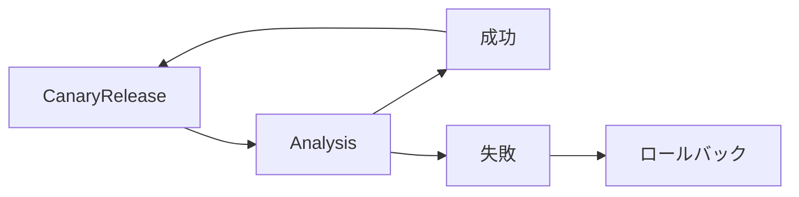

# Argo Rollouts

この章では、Kubernetes でプログレッシブデリバリーを行うツール、Argo Rollouts を使います。Blue/Green Deployment と Canary Release で新しい版を出したあと、新しい版を測った結果で、リリースを自動で進めたり止めたりします。

## プログレッシブデリバリー

プログレッシブデリバリーは、新しい版を少しずつ公開し、問題があれば自動で戻すリリースの方法です。まずトラフィックの一部だけを新しい版に流し、その間にエラー率などを測ります。結果が良ければ割合を増やし、悪ければ元の版に戻します。この「測って決める」部分を、Argo Rollouts では Analysis と呼びます。



Deployment のローリングアップデートは、readiness probe が通れば、Pod を新しい版に入れ替えていきます。エラーを返す版でも、起動さえすれば利用者の全員に届きます。

プログレッシブデリバリーでは、新しい版に届くのは一部のリクエストだけです。問題が見つかれば、全員に届く前に元の版へ自動で戻ります。進めるかどうかの基準は AnalysisTemplate に書くので、Git でレビューできます。

この流れは、章の最後の「失敗する例」で試します。

## Argo Rollouts

Argo Rollouts は、Kubernetes にプログレッシブデリバリーの機能を足すコントローラーとカスタムリソースです。


| リソース | 役割 |
|---|---|
| Rollout | Deployment の代わりに使う。Blue/Green や Canary などの更新のしかたを書く |
| AnalysisTemplate | 何をどう測って成功とするかを書いたテンプレート |
| AnalysisRun | AnalysisTemplate を元に、実際に行った Analysis。結果が残る |

Argo CD と組み合わせると、Git の変更をきっかけにプログレッシブデリバリーを進められます。

## 準備

### Prometheus

Analysis で Envoy Gateway のメトリクスを使います。[chapter_prometheus](../chapter_prometheus/README.md) の手順で kube-prometheus-stack を入れます。そのうえで、Envoy Gateway のメトリクスを集める PodMonitor を作ります。

```bash
kubectl apply -f ../chapter_prometheus/manifests/envoy-gateway-podmonitor.yaml
```

### Argo CD

[chapter_argocd](../chapter_argocd/README.md) の「準備」を終えます。fork を作り、`GITHUB_USER` を設定し、Argo CD を入れた状態から始めます。

Argo CD の章の [helm/values.yaml](../chapter_argocd/helm/values.yaml) には、rollout-extension が入っています。rollout-extension は、Rollout の状態を Argo CD の Web UI に表示する拡張機能です。

この章のディレクトリに移ります。

```bash
cd ~/cnd-handson/chapter_argo-rollouts
```

### Argo Rollouts のインストール

helmfile で Argo Rollouts を入れます。

```bash
helmfile sync -f helm/helmfile.yaml
```

```bash
kubectl -n argo-rollouts get deployments
```

```
# 実行結果
NAME            READY   UP-TO-DATE   AVAILABLE   AGE
argo-rollouts   2/2     2            2           60s
```

[helm/values.yaml](helm/values.yaml) では、Gateway API のプラグインを読み込みます。Canary Release で、Rollout が HTTPRoute の重みを書き換えるのに使います。

## Blue/Green Deployment

Blue/Green Deployment では、新しい版を用意し終えてから、トラフィックを一度に切り替えます。新旧の版が混ざりません。

[app/blue-green/rollout.yaml](app/blue-green/rollout.yaml) の `strategy` に、2 つの Service を書きます。

```yaml
  strategy:
    blueGreen:
      activeService: handson
      previewService: handson-preview
      autoPromotionEnabled: false
```

- `activeService` は、利用者が使う版に向く Service です。
- `previewService` は、新しい版に向く Service です。切り替える前に、新しい版を確かめるのに使います。
- `autoPromotionEnabled: false` にしているので、切り替え（Promote）は手で行います。

Application を作ります。`automated` を書いているので、作るとすぐに同期します。

```bash
sed "s/<GITHUB_USER>/${GITHUB_USER}/" applications/blue-green.yaml | kubectl apply -f -
```

http://app.rollouts.example.com を開くと、青いタイルが並びます。

fork の [app/blue-green/rollout.yaml](app/blue-green/rollout.yaml) を GitHub の画面で開き、image のタグを `blue` から `green` に変えてコミットします。手順は [Argo CD の章](../chapter_argocd/README.md#git-を変えて反映する) と同じです。

```yaml
        image: argoproj/rollouts-demo:green
```

Argo CD が変更に気づくまで 3 分ほどかかります。待てないときは Web UI で blue-green を開き、REFRESH をクリックします。

同期すると、新しい版の Pod が作られます。2 つの URL を開くと、色が違います。

- active: http://app.rollouts.example.com （青）
- preview: http://app-preview.rollouts.example.com （緑）


Web UI で blue-green を開き、Rollout（handson）の「⋮」から Promote-Full をクリックし、確認の画面で OK をクリックします。active も緑に切り替わり、古い版の Pod は少し待ってから消えます。

rollout-extension が入っていれば、Rollout をクリックしたときに ROLLOUT のタブが出ます。新旧の版の状態を、まとめて確かめられます。

Application を消します。

```bash
kubectl -n argo-cd delete application blue-green
```

## Canary Release

Canary Release では、トラフィックの一部だけを新しい版に流し、少しずつ割合を増やします。

この章では、Rollout が HTTPRoute の重みを書き換えて、トラフィックを分けます。[app/canary/httproute.yaml](app/canary/httproute.yaml) には、2 つの Service を重み付きで並べます。

```yaml
    backendRefs:
    - name: handson
      port: 80
      weight: 100
    - name: handson-canary
      port: 80
      weight: 0
```

[app/canary/rollout.yaml](app/canary/rollout.yaml) では、どの HTTPRoute を書き換えるかと、割合の変え方を書きます。

```yaml
  strategy:
    canary:
      stableService: handson
      canaryService: handson-canary
      trafficRouting:
        plugins:
          argoproj-labs/gatewayAPI:
            httpRoute: app-httproute
            namespace: canary
      steps:
      - setWeight: 20
      - pause: {}
```

- `stableService` は今の版、`canaryService` は新しい版に向く Service です。
- `setWeight: 20` で、新しい版に 20% を流します。
- `pause: {}` で止まります。先に進めるのは手で行います。

Application を作ります。

```bash
sed "s/<GITHUB_USER>/${GITHUB_USER}/" applications/canary.yaml | kubectl apply -f -
```

fork の [app/canary/rollout.yaml](app/canary/rollout.yaml) で、image のタグを `blue` から `green` に変えてコミットします。

同期すると、HTTPRoute の重みが 80 と 20 に変わります。

```bash
kubectl -n canary get httproute app-httproute -o jsonpath='{.spec.rules[0].backendRefs}'; echo
```

```
# 実行結果
[{"group":"","kind":"Service","name":"handson","port":80,"weight":80},{"group":"","kind":"Service","name":"handson-canary","port":80,"weight":20}]
```

http://app.rollouts.example.com を開くと、青いタイルの中に、緑のタイルが 2 割ほど混ざります。


Web UI で canary を開き、Rollout の「⋮」から Promote-Full をクリックし、確認の画面で OK をクリックします。すべてのトラフィックが新しい版に流れ、タイルが緑だけになります。

Application を消します。

```bash
kubectl -n argo-cd delete application canary
```

## Analysis で進めるか決める

ここまでは、切り替えを手で行いました。Analysis を使うと、新しい版を測った結果で、先に進めるか止めるかを Argo Rollouts が決めます。

Analysis の方法はいくつかあります。この章では、Job、Web、Prometheus の 3 つを試します。

### Job

Job を実行し、終了コードで成功か失敗かを決めます。[analysis/job/analysis.yaml](analysis/job/analysis.yaml) の Job は、`exit 0` で終わるので成功します。

[analysis/job/rollout.yaml](analysis/job/rollout.yaml) では、`postPromotionAnalysis` でこの Analysis を使います。Blue/Green で切り替えたあとに Analysis を行います。

```yaml
  strategy:
    blueGreen:
      activeService: handson
      previewService: handson-preview
      postPromotionAnalysis:
        templates:
        - templateName: handson-analysis
```

`autoPromotionEnabled` を書いていないので、新しい版の準備ができると自動で切り替わります。

Application を作ります。

```bash
sed "s/<GITHUB_USER>/${GITHUB_USER}/" applications/job-analysis.yaml | kubectl apply -f -
```

fork の [analysis/job/rollout.yaml](analysis/job/rollout.yaml) で、image のタグを `blue` から `green` に変えてコミットします。

同期して切り替わると、AnalysisRun が作られ、Job が実行されます。

```bash
kubectl -n job-analysis get analysisrun
```

```
# 実行結果
NAME                       STATUS       AGE
handson-d7d97867f-2-post   Successful   30s
```

Application を消します。

```bash
kubectl -n argo-cd delete application job-analysis
```

### Web

HTTP でリクエストを送り、レスポンスで成功か失敗かを決めます。[analysis/web/analysis.yaml](analysis/web/analysis.yaml) では、新しい版の `/color` が `green` を返せば成功にします。

```yaml
  metrics:
  - name: handson-analysis
    successCondition: result == "green"
    failureLimit: 3
    provider:
      web:
        url: "http://handson-preview.web-analysis.svc.cluster.local/color"
```

Application を作ります。

```bash
sed "s/<GITHUB_USER>/${GITHUB_USER}/" applications/web-analysis.yaml | kubectl apply -f -
```

fork の [analysis/web/rollout.yaml](analysis/web/rollout.yaml) で、image のタグを `blue` から `green` に変えてコミットします。

同期して切り替わると、AnalysisRun が作られます。新しい版は `green` を返すので、Analysis は成功します。

```bash
kubectl -n web-analysis get analysisrun
```

```
# 実行結果
NAME                       STATUS       AGE
handson-d7d97867f-2-post   Successful   30s
```

Application を消します。

```bash
kubectl -n argo-cd delete application web-analysis
```

### Prometheus

Prometheus にクエリを送り、結果で成功か失敗かを決めます。ここでは、Canary Release の途中で成功率を測ります。成功率が下がったら、自動で元の版に戻します。

[analysis/prometheus/analysis.yaml](analysis/prometheus/analysis.yaml) では、HTTPRoute を通ったリクエストのうち、5xx と 4xx 以外の割合を出します。Envoy Gateway のメトリクスを使います。

```yaml
  metrics:
  - name: handson-analysis
    interval: 15s
    count: 4
    successCondition: isNaN(result[0]) || result[0] >= 0.95
    failureLimit: 0
    provider:
      prometheus:
        address: http://kube-prometheus-stack-prometheus.prometheus.svc.cluster.local:9090
        query: >+
          sum(rate(envoy_cluster_upstream_rq_xx{envoy_cluster_name="{{args.envoy-cluster}}",envoy_response_code_class!~"4|5"}[1m]))
          /
          sum(rate(envoy_cluster_upstream_rq_xx{envoy_cluster_name="{{args.envoy-cluster}}"}[1m]))
```

- 15 秒おきに 4 回測ります。
- 成功率が 95% 以上なら成功です。リクエストがなく NaN のときも、成功として扱います。
- `failureLimit: 0` なので、1 回でも下回ったら失敗です。

[analysis/prometheus/rollout.yaml](analysis/prometheus/rollout.yaml) では、20% 流したところで Analysis を行います。

```yaml
      steps:
      - setWeight: 20
      - analysis:
          templates:
          - templateName: handson-analysis
          args:
          - name: envoy-cluster
            value: httproute/prometheus-analysis/app-httproute/rule/0
      - setWeight: 50
      - pause:
          duration: 30s
```

Analysis が成功するまで、50% には進みません。失敗したら、Rollout は中止され、トラフィックは元の版に戻ります。

Application を作ります。

```bash
sed "s/<GITHUB_USER>/${GITHUB_USER}/" applications/prometheus-analysis.yaml | kubectl apply -f -
```

Analysis にはリクエストが要ります。http://app.rollouts.example.com を開いたままにしておきます。デモアプリの画面は、裏で繰り返しリクエストを送ります。

#### 成功する例

fork の [analysis/prometheus/rollout.yaml](analysis/prometheus/rollout.yaml) で、image のタグを `blue` から `green` に変えてコミットします。

同期すると、20% で Analysis が始まります。1 分ほどで Analysis が成功し、50%、100% と自動で進みます。画面のタイルも、緑が増えていきます。

```bash
kubectl -n prometheus-analysis get analysisrun
```

```
# 実行結果
NAME                    STATUS       AGE
handson-d7d97867f-2-1   Successful   2m
```

#### 失敗する例

`argoproj/rollouts-demo:bad-red` は、一部のリクエストにエラーを返すイメージです。これを新しい版として出します。

fork の [analysis/prometheus/rollout.yaml](analysis/prometheus/rollout.yaml) で、image のタグを `green` から `bad-red` に変えてコミットします。

```yaml
        image: argoproj/rollouts-demo:bad-red
```

同期すると、20% で Analysis が始まります。画面には、赤いタイルとエラーが混ざります。成功率が 95% を下回ると Analysis が失敗し、Rollout が中止されます。

```bash
kubectl -n prometheus-analysis get rollout handson -o jsonpath='{.status.message}'; echo
```

```
# 実行結果
RolloutAborted: Rollout aborted update to revision 3: Step-based analysis phase error/failed: Metric "handson-analysis" assessed Failed due to failed (1) > failureLimit (0)
```

HTTPRoute の重みは 100 と 0 に戻り、トラフィックはすべて緑の版に流れます。画面に新しく並ぶタイルも、緑だけになります。

Web UI では、prometheus-analysis の Rollout が Degraded になります。Git には `bad-red` が残っているので、直すときは Git の image のタグを戻します。

`bad-red` に届いたのは 20% のリクエストだけです。全員に届く前に、Argo Rollouts が元の版に戻しました。

Application を消します。

```bash
kubectl -n argo-cd delete application prometheus-analysis
```

## 片付け

> [!WARNING]
> chapter_argocd-image-updater に進む場合は、Argo CD を消さないでください。

Application を消していない場合は、消します。

```bash
kubectl -n argo-cd delete application blue-green canary job-analysis web-analysis prometheus-analysis --ignore-not-found
```

namespace を消します。

```bash
kubectl delete namespace blue-green canary job-analysis web-analysis prometheus-analysis --ignore-not-found
```

Argo Rollouts を消します。

```bash
helmfile destroy -f helm/helmfile.yaml
kubectl delete namespace argo-rollouts
```
