# Argo CD

この章では、Kubernetes で GitOps を行う CD ツールの Argo CD を使います。

- Argo CD を入れて、Web UI を開きます。
- Application を YAML で書き、`kubectl apply` で作ります。
- Git を変えるとクラスタに反映されることを確かめます。
- クラスタを手で変えても Git の状態に戻ることを確かめます。
- Kustomize と Helm のマニフェストをデプロイします。

Argo CD の Config Management Plugin（CMP）を試したい方は、この章のあとに [Argo CD with CMP](./README_cmp.md) に進んでください。

## GitOps と Argo CD

GitOps は、Git のマニフェストを正としてクラスタをその状態に保つ運用です。

- デプロイは Git への push で行います。
- クラスタの状態がずれたら、Git の状態に戻します。
- 変更の履歴とレビューは Git に残ります。

Argo CD は Git のマニフェストとクラスタの状態を比べ続け、差分があれば OutOfSync と表示します。同期するとクラスタが Git に合わせられます。同期は手で行うことも、自動にすることもできます。

### Argo CD のアーキテクチャ


Argo CD は次のコンポーネントで動きます。

| コンポーネント | 役割 |
|---|---|
| API Server（`argocd-server`） | Web UI と API を提供する |
| Repository Server（`argocd-repo-server`） | Git からマニフェストを取り出す。Helm や Kustomize の描画もここで行う |
| Application Controller（`argocd-application-controller`） | Git とクラスタを比べ、差分をクラスタに反映する |
| ApplicationSet Controller（`argocd-applicationset-controller`） | テンプレートから Application をまとめて作る |
| Notifications Controller（`argocd-notifications-controller`） | 同期の結果を Slack などに通知する |
| Dex（`argocd-dex-server`） | GitHub などの外部 ID でログインできるようにする |
| Redis（`argocd-redis`） | 描画したマニフェストなどをキャッシュする |

### Application

Argo CD では、デプロイの単位を Application というカスタムリソースで書きます。Application には、どの Git のどのディレクトリを、どの namespace に入れるかを書きます。アプリそのものではなく、デプロイのしかたを書いた設定です。

```yaml
apiVersion: argoproj.io/v1alpha1
kind: Application
metadata:
  name: example
  namespace: argo-cd
spec:
  source:        # どの Git の、どのディレクトリを使うか
    repoURL: https://github.com/<GITHUB_USER>/cnd-handson
    targetRevision: main
    path: chapter_argocd/app/default
  destination:   # どのクラスタの、どの namespace に入れるか
    server: https://kubernetes.default.svc
    namespace: example
```

Web UI や `argocd` コマンドで作った Application も、中身はこのリソースです。この章では YAML で書き、`kubectl apply` で作ります。

### 同期の状態

Git とクラスタが一致しているかを表します。

| 状態 | 意味 |
|---|---|
| Synced | クラスタが Git と一致している |
| OutOfSync | クラスタが Git と一致していない |
| Unknown | 比べられなかった。Git に繋がらないときなどに出る |

### ヘルスの状態

デプロイしたリソースが正しく動いているかを表します。

| 状態 | 意味 |
|---|---|
| Healthy | 正しく動いている |
| Progressing | 動き出す途中。時間が経つと Healthy か Degraded になる |
| Degraded | 失敗している。Pod が起動しないときなどに出る |
| Suspended | 止まっている。CronJob を止めたときなどに出る |
| Missing | Git にはあるが、クラスタにない |
| Unknown | 判定できない |

### Refresh、Hard Refresh、Sync

| 操作 | 内容 |
|---|---|
| Refresh | Git の最新のマニフェストとクラスタを比べ直す |
| Hard Refresh | マニフェストのキャッシュを捨ててから、Refresh する |
| Sync | クラスタを Git の状態に合わせる |

- Refresh は 2〜3 分ごとに自動で行われます。既定の間隔 120 秒に、最大 60 秒の揺らぎが足されます。
- Helm や Kustomize で描画したマニフェストはキャッシュされ、24 時間で切れます。
- 待てないときは、Web UI の REFRESH ボタンで Refresh できます。

## 準備

### リポジトリを fork する

Argo CD は Git の変更を見てデプロイします。この章では GitHub 上でファイルを変えるので、このリポジトリを自分のアカウントに fork します。

[このハンズオンのリポジトリ](https://github.com/cloudnativedaysjp/cnd-handson)を開き、Fork をクリックします。

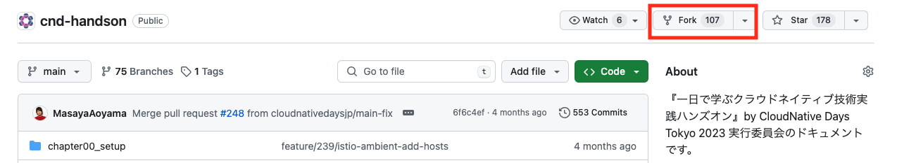

Create fork をクリックします。

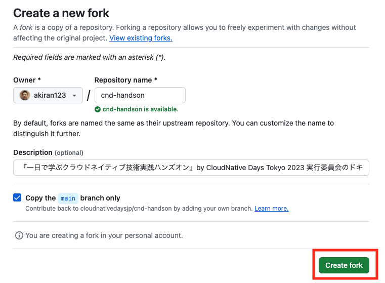

自分のアカウントに fork されたことを確かめます。

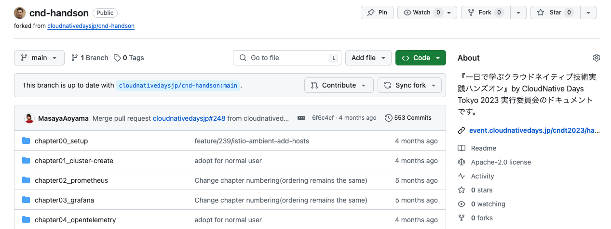

fork は clone せず、Git の変更は GitHub の画面で行います。

自分のアカウント名を変数に入れ、VM にあるこのリポジトリの `chapter_argocd` に移ります。

```bash
export GITHUB_USER=<自分の GitHub アカウント名>
cd ~/cnd-handson/chapter_argocd
```

以降の手順は `chapter_argocd` で実行します。

### Argo CDのインストール

helmfile で Argo CD を入れます。

```bash
helmfile sync -f helm/helmfile.yaml
```

Pod がすべて Running になるまで待ちます。

```bash
kubectl -n argo-cd get pods
```

```
# 実行結果
NAME                                                       READY   STATUS      RESTARTS   AGE
argo-cd-argocd-application-controller-0                    1/1     Running     0          60s
argo-cd-argocd-applicationset-controller-d68c4c54d-zct8m   1/1     Running     0          60s
argo-cd-argocd-dex-server-f68dccffb-smmlp                  1/1     Running     0          60s
argo-cd-argocd-notifications-controller-545b4749f4-7l5gm   1/1     Running     0          60s
argo-cd-argocd-redis-86c47569c-jwzwf                       1/1     Running     0          60s
argo-cd-argocd-repo-server-5489fdcf4b-frk86                2/2     Running     0          60s
argo-cd-argocd-server-7c99cfccdb-dghsj                     1/1     Running     0          60s
```

repo-server の Pod にはコンテナが 2 つあります。2 つ目は CMP 用で、[Argo CD with CMP](./README_cmp.md) で使います。

### Web UI を開く

HTTPRoute を作って Web UI を開けるようにします。HTTPRoute は [chapter_cluster-create](../chapter_cluster-create/) で作った `handson-gateway` に紐付けます。

```bash
kubectl apply -f httproute/httproute.yaml
```

admin のパスワードを確かめます。

```bash
kubectl -n argo-cd get secret argocd-initial-admin-secret -o jsonpath="{.data.password}" | base64 -d ; echo
```

http://argocd.example.com を開き、ログインします。

- ユーザー名: `admin`
- パスワード: 上で確かめた値

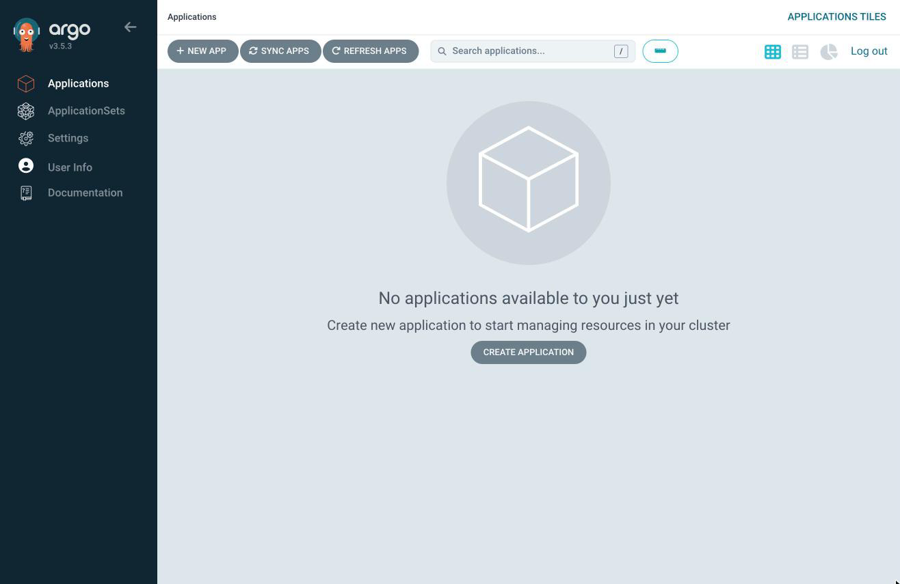

この章では Web UI を状態の確認に使い、Application は YAML で作ります。

> [!NOTE]
> 公開リポジトリは Argo CD に登録しなくても使えます。プライベートリポジトリを使うときは、Settings > Repositories で認証情報を登録します。

## Application の中身を読む

この章では、タスク管理のアプリ [cnd-handson-app](https://github.com/cloudnativedaysjp/cnd-handson-app) をデプロイします。アプリは画面とバックエンドでできています。

- 画面: ブラウザで開くところ。legacy（表形式）と modern（カンバン）の 2 つの版がある
- バックエンド: ログインやタスクを扱うところ。Postgres と 4 つのサービスでできている

アプリ 1 つを Application 1 つで入れるので、画面とバックエンドは同じ namespace に入ります。

Application を作る前に YAML を読みます。[applications/demo.yaml](applications/demo.yaml) は、アプリを argocd-demo namespace に入れる Application です。

```yaml
apiVersion: argoproj.io/v1alpha1
kind: Application
metadata:
  name: argocd-demo
  namespace: argo-cd
  finalizers:
  - resources-finalizer.argocd.argoproj.io/foreground
spec:
  project: default
  sources:
  # 画面
  - repoURL: https://github.com/<GITHUB_USER>/cnd-handson
    targetRevision: main
    path: chapter_argocd/app/default
  # バックエンド
  - repoURL: https://github.com/cloudnativedaysjp/cnd-handson-app
    targetRevision: main
    path: deploy/helm/handson
    helm:
      values: |
        entry:
          variants: null
  destination:
    server: https://kubernetes.default.svc
    namespace: argocd-demo
  ignoreDifferences:
  - kind: Secret
    name: handson-secrets
    jsonPointers:
    - /data
  syncPolicy:
    syncOptions:
    - CreateNamespace=true
    - RespectIgnoreDifferences=true
```

| フィールド | 意味 |
|---|---|
| `metadata.namespace` | Application 自体を置く namespace。Argo CD を入れた argo-cd にする |
| `metadata.finalizers` | Application を消したときに、デプロイしたリソースも消す |
| `spec.project` | Application をまとめる単位。この章では既定の default を使う |
| `spec.sources` | マニフェストを取り出す場所の一覧。1 つだけなら `source` と書く |
| `sources[].repoURL` | マニフェストを取り出す Git リポジトリ |
| `sources[].targetRevision` | 使うブランチ。タグやコミットも書ける |
| `sources[].path` | リポジトリの中の、マニフェストがあるディレクトリ |
| `spec.destination.server` | デプロイ先のクラスタ。`https://kubernetes.default.svc` は Argo CD 自身が動くクラスタ |
| `spec.destination.namespace` | デプロイ先の namespace |
| `spec.ignoreDifferences` | Git とクラスタを比べるときに、無視するところ |
| `spec.syncPolicy.syncOptions` | 同期の細かい設定 |

`sources` には 2 つの場所を書いています。

- 画面は自分の fork の [app/default](app/default) から入れます。この章ではこちらを書き換えます。
- バックエンドは cnd-handson-app リポジトリの Helm chart から入れます。chart には画面（`entry`）も入っているので、`helm.values` で外しています。

`path` のディレクトリに何があるかで、Argo CD はマニフェストの作り方を変えます。

- YAML が並んでいるだけなら、そのまま使う
- `kustomization.yaml` があれば、Kustomize で描画する
- `Chart.yaml` があれば、Helm で描画する

`ignoreDifferences` と `RespectIgnoreDifferences=true` は、バックエンドの Secret のための設定です。

- バックエンドの chart は DB のパスワードと署名鍵を Secret に入れます。この値は描画のたびに作り直されます。
- `ignoreDifferences` で Secret の値を比較から外します。値が変わっても OutOfSync になりません。
- `RespectIgnoreDifferences=true` を付けると、同期のときも Secret の値を上書きせず、最初に作った値が残ります。

その代わり、chart の values で Secret の値を変えても、クラスタの Secret には反映されません。

`CreateNamespace=true` は namespace がなければ作る設定です。

`syncPolicy` に `automated` を書くと Git の変更を自動で同期しますが、demo.yaml には書いていないので手で同期します。

## Application を作る

[Application の中身を読む](#application-の中身を読む) で見た demo.yaml を作ります。バックエンドと [app/default](app/default) の画面が、argocd-demo namespace に入ります。

`repoURL` の `<GITHUB_USER>` を自分のアカウント名に置き換えて作ります。

```bash
sed "s/<GITHUB_USER>/${GITHUB_USER}/" applications/demo.yaml | kubectl apply -f -
```

`automated` を書いていないので自動では同期せず、Application は OutOfSync のまま止まります。

```bash
kubectl -n argo-cd get applications argocd-demo
```

```
# 実行結果
NAME          SYNC STATUS   HEALTH STATUS
argocd-demo   OutOfSync     Missing
```

Web UI で argocd-demo を開くと、Git にあるリソースがまだクラスタにないことが分かります。

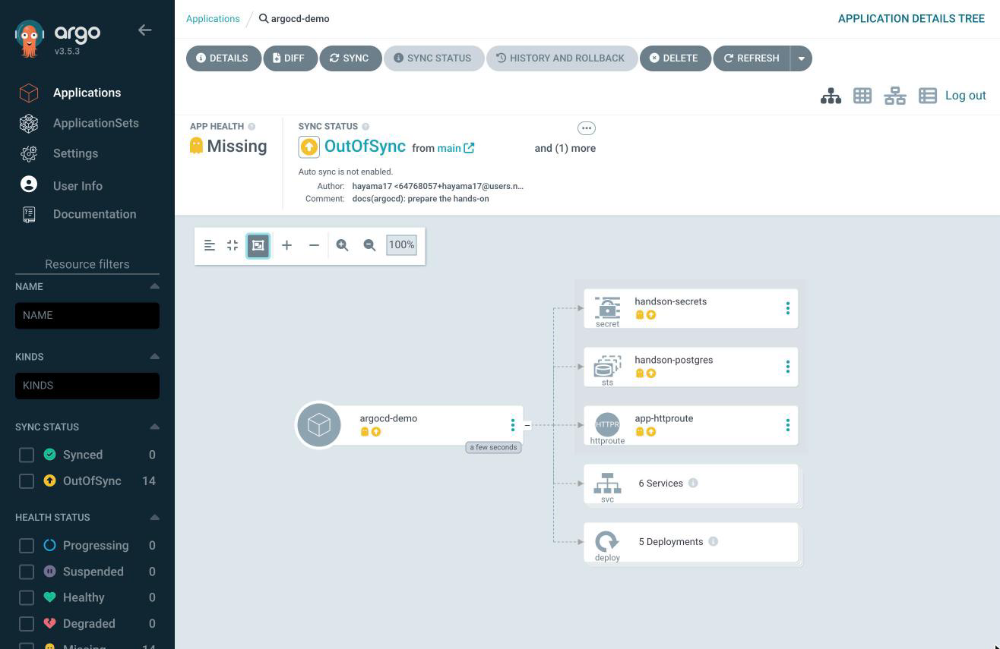

画面上部の SYNC をクリックし、SYNCHRONIZE をクリックします。リソースが作られ、Synced と Healthy になります。

同期した直後は、Synced でも Progressing のままです。Synced はクラスタが Git と一致していること、Healthy は Pod などが動いていることを表すので、Pod が起動するまで Healthy になりません。

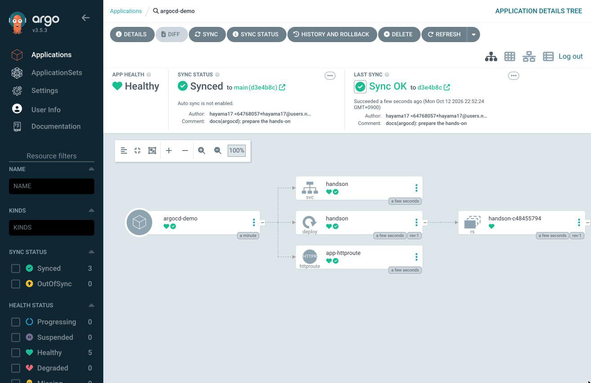

http://app.argocd.example.com を開きます。ログイン画面が出たら、次のユーザーでログインします。

- メールアドレス: `demo@example.com`
- パスワード: `demo-password`

表形式の画面（legacy）が表示されます。

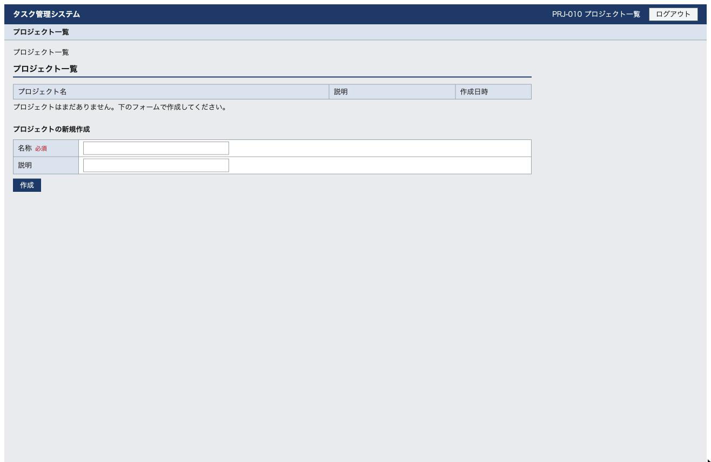

## 自動で同期する

Git を変えたら自動でクラスタに反映されるようにします。

applications/demo.yaml の `syncPolicy` に `automated` を足します。

```yaml
  syncPolicy:
    automated:
      selfHeal: true
    syncOptions:
    - CreateNamespace=true
    - RespectIgnoreDifferences=true
```

- `automated` を書くと、Git が変わったときに自動で同期します。
- `selfHeal: true` を書くと、クラスタを手で変えたときも Git の状態に戻します。

Application を更新します。

```bash
sed "s/<GITHUB_USER>/${GITHUB_USER}/" applications/demo.yaml | kubectl apply -f -
```

### Git を変えて反映する

fork の [app/default/deployment.yaml](app/default/deployment.yaml) を GitHub の画面で変えます。

ブラウザで次の URL を開きます。`<GITHUB_USER>` は自分のアカウント名に置き換えます。

```
https://github.com/<GITHUB_USER>/cnd-handson/blob/main/chapter_argocd/app/default/deployment.yaml
```

右上の鉛筆アイコンをクリックし、編集画面を開きます。

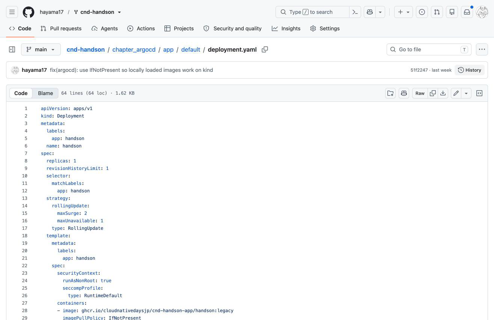

image のタグを `legacy` から `modern` に変えます。

```yaml
      - image: ghcr.io/cloudnativedaysjp/cnd-handson-app/handson:modern
```

Commit changes をクリックします。Commit directly to the `main` branch を選んだまま、もう一度 Commit changes をクリックします。

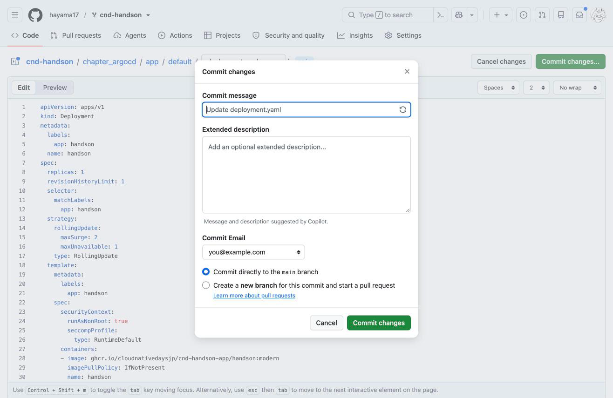

Argo CD が変更に気づくまで 3 分ほどかかります。待てないときは Web UI で argocd-demo を開き、REFRESH をクリックします。

Argo CD が自動で同期し、新しい Pod に入れ替わります。

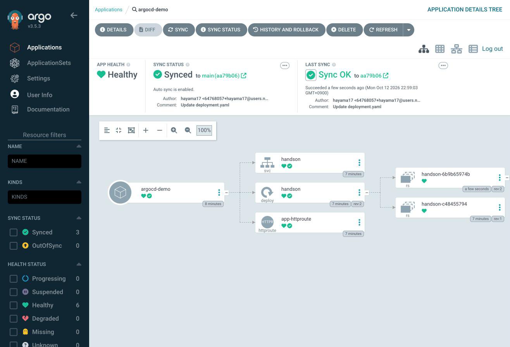

http://app.argocd.example.com を開き直すと、カンバンの画面（modern）に変わっています。表示が変わらなければブラウザで再読み込みし、ログイン画面が出たら同じユーザーでログインします。

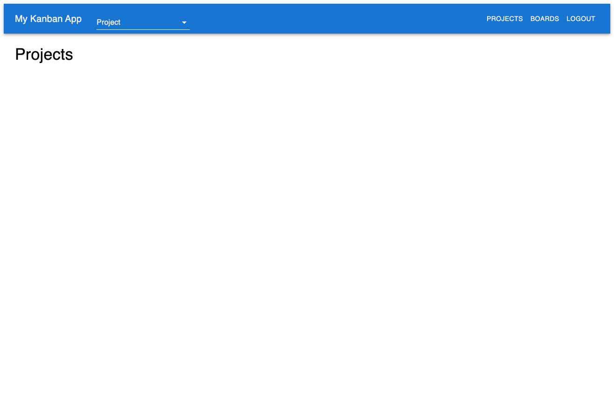

### 手で変えた状態を戻す

kubectl で Deployment のレプリカ数を 3 に変え、そのままレプリカ数の変化を見ます。selfHeal で自動的に戻るので、変化を見逃さないよう 2 つのコマンドを続けて実行します。

```bash
kubectl -n argocd-demo scale deployment handson --replicas=3 && kubectl -n argocd-demo get deployment handson -w
```

Git ではレプリカ数が 1 なので、Argo CD が差分に気づいて 1 に戻します。確かめたら Ctrl+C で止めます。

```
# 実行結果
deployment.apps/handson scaled
NAME      READY   UP-TO-DATE   AVAILABLE   AGE
handson   1/3     3            1           10m
handson   1/1     1            1           10m
```

クラスタを変えたいときは、kubectl ではなく Git を変えます。

> [!NOTE]
> Git からマニフェストを消しても、既定ではクラスタのリソースは消えません。消すには `automated` に `prune: true` を足します。

## Kustomize と ApplicationSet

Kustomize で開発環境（dev）と本番環境（prd）のマニフェストを作り分けます。

| 環境 | ディレクトリ | 画面 | レプリカ数 |
|---|---|---|---|
| dev | [app/Kustomize/overlays/dev](app/Kustomize/overlays/dev) | legacy | 1 |
| prd | [app/Kustomize/overlays/prd](app/Kustomize/overlays/prd) | modern | 2 |

どちらも [app/Kustomize/base](app/Kustomize/base) を元にし、各 overlay では違うところだけを上書きします。バックエンドは環境ごとに 1 つずつ入ります。

dev と prd の Application は、環境の名前しか違いません。こういうときは ApplicationSet を使い、テンプレートから Application をまとめて作ります。

[applications/kustomize.yaml](applications/kustomize.yaml) では `generators` に環境の一覧を書き、テンプレートの `{{ .env }}` を一覧の値で置き換えます。

```yaml
  generators:
  - list:
      elements:
      - env: dev
      - env: prd
  template:
    metadata:
      name: argocd-kustomize-{{ .env }}
```

ApplicationSet を作ります。

```bash
sed "s/<GITHUB_USER>/${GITHUB_USER}/" applications/kustomize.yaml | kubectl apply -f -
```

Application が 2 つ作られます。テンプレートに `automated` を書いているので、作られた Application はすぐに同期します。

```bash
kubectl -n argo-cd get applications
```

```
# 実行結果
NAME                   SYNC STATUS   HEALTH STATUS
argocd-demo            Synced        Healthy
argocd-kustomize-dev   Synced        Healthy
argocd-kustomize-prd   Synced        Healthy
```

各環境を開きます。dev は表形式の画面（legacy）、prd はカンバンの画面（modern）です。

- dev: http://dev.kustomize.argocd.example.com
- prd: http://prd.kustomize.argocd.example.com

prd の Pod は 2 つです。

```bash
kubectl -n argocd-kustomize-prd get pods
```

Web UI で argocd-kustomize-prd を開くと、handson の Pod が 2 つ並んでいます。

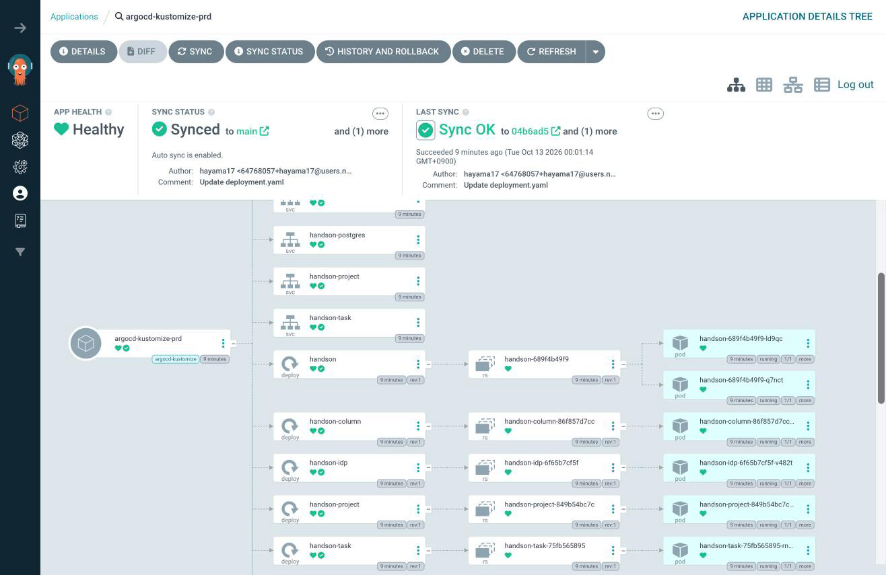

ApplicationSet が作った Application は、ApplicationSet が管理します。Application だけを消しても作り直されるので、消すときは ApplicationSet を消します。

## Helm

Kustomize は、元の YAML に環境ごとの差分を重ねて作り分けます。Helm は、テンプレートに values を埋め込んで描画するので、Application から values を変えるだけで中身を変えられます。

[app/Helm/handson](app/Helm/handson) は画面の Helm chart です。バックエンドはこれまでと同じく cnd-handson-app の chart から入れます。[values.yaml](app/Helm/handson/values.yaml) では画面を legacy にしています。

```yaml
image:
  repository: ghcr.io/cloudnativedaysjp/cnd-handson-app/handson
  tag: legacy
```

Application から values を上書きできます。[applications/helm.yaml](applications/helm.yaml) では画面を modern にしています。

```yaml
  # 画面
  - repoURL: https://github.com/<GITHUB_USER>/cnd-handson
    targetRevision: main
    path: chapter_argocd/app/Helm/handson
    helm:
      valuesObject:
        image:
          tag: modern
```

Application を作ります。

```bash
sed "s/<GITHUB_USER>/${GITHUB_USER}/" applications/helm.yaml | kubectl apply -f -
```


http://helm.argocd.example.com を開くと、カンバンの画面（modern）が表示されます。

## 片付け

> [!WARNING]
> chapter_cicd、chapter_argocd-image-updater、chapter_argo-rollouts に進む場合は、Argo CD を消さないでください。

Application と ApplicationSet を消します。finalizer を付けているので、デプロイしたリソースも一緒に消えます。

```bash
kubectl -n argo-cd delete applicationset argocd-kustomize
kubectl -n argo-cd delete application argocd-demo argocd-helm
```

namespace を消します。

```bash
kubectl delete namespace argocd-demo argocd-kustomize-dev argocd-kustomize-prd argocd-helm
```

最後に Argo CD を消します。

```bash
kubectl delete namespace argo-cd
```
