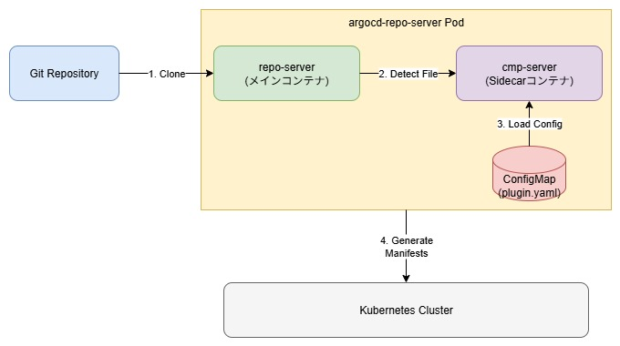
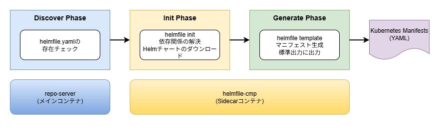
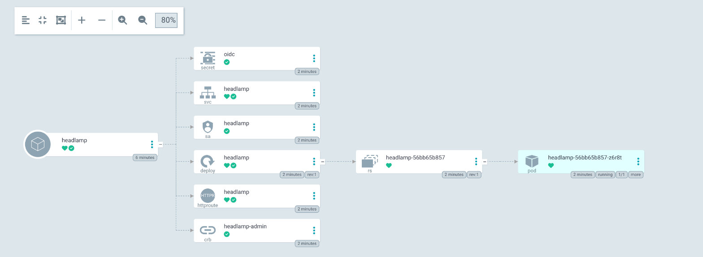

# Argo CD with CMP

Argo CD がマニフェストを作れるのは、YAML、Kustomize、Helm などに限られます。それ以外のツールでマニフェストを作りたいときは、Config Management Plugin（CMP）を使います。CMP が受け持つのは、マニフェストを作るところまでです。作ったマニフェストの差分の検出や同期は、ほかの Application と同じく Argo CD が行います。

この章では、Helmfile を CMP として使い、[Headlamp](https://headlamp.dev/) をデプロイします。

- Argo CD に入っている CMP の設定を読みます。
- `helmfile.yaml` を置いたディレクトリを、Application でデプロイします。

[Argo CD](./README.md) の章の「準備」を終え、Argo CD が動いている状態から始めます。`GITHUB_USER` を設定し、`chapter_argocd` に移っておきます。

## CMP の仕組み

CMP は、repo-server の Pod にサイドカーとして入ります。サイドカーのイメージには、Helmfile のようなマニフェストを作るツールを入れておきます。



repo-server は、Git から取り出したディレクトリをサイドカーに渡します。サイドカーは、プラグインの設定に従ってマニフェストを作ります。この章のプラグインは、次の 3 つを順に行います。



| 段階 | 内容 |
|---|---|
| discover | このプラグインで描画するディレクトリかを判定する。この章では `helmfile.yaml` があるかを見る |
| init | 描画の前の準備をする。この章では `helmfile deps` で chart を取得する |
| generate | マニフェストを標準出力に書き出す。この章では `helmfile template` を実行する |

Application の `path` に `helmfile.yaml` があれば、Argo CD は自動でこのプラグインを選びます。Application にプラグイン名を書く必要はありません。

## Argo CD に入っている CMP の設定

この章で使う CMP は、Argo CD の章で Argo CD を入れたときに、もう入っています。[helm/values.yaml](helm/values.yaml) の 2 か所で設定しています。

`configs.cmp` には、プラグインの設定を書きます。Argo CD の chart が、この内容から `argocd-cmp-cm` という ConfigMap を作ります。

```yaml
configs:
  cmp:
    create: true
    plugins:
      helmfile-plugin:
        discover:
          fileName: "helmfile.yaml"
        init:
          command: [sh, -c]
          args:
            - |
              echo "Initializing..."
              helmfile deps
        generate:
          command: [sh, -c]
          args:
            - |
              helmfile template --include-crds --skip-deps || exit 1
```

`repoServer.extraContainers` には、サイドカーを書きます。

```yaml
repoServer:
  extraContainers:
    - name: helmfile-cmp
      command: [/var/run/argocd/argocd-cmp-server]
      image: ghcr.io/helmfile/helmfile:latest
      env:
        - name: HELM_CACHE_HOME
          value: /tmp/helm/cache
        - name: HELM_CONFIG_HOME
          value: /tmp/helm/config
        - name: HELM_DATA_HOME
          value: /tmp/helm/data
      securityContext:
        runAsNonRoot: true
        runAsUser: 999
      volumeMounts:
        - mountPath: /var/run/argocd
          name: var-files
        - mountPath: /home/argocd/cmp-server/plugins
          name: plugins
        - mountPath: /home/argocd/cmp-server/config/plugin.yaml
          subPath: helmfile-plugin.yaml
          name: argocd-cmp-cm
        - mountPath: /tmp
          name: cmp-tmp
```

- `command` の `argocd-cmp-server` は、repo-server とやり取りするためのプログラムです。repo-server が `/var/run/argocd` に置いたものを使います。
- `argocd-cmp-cm` の `helmfile-plugin.yaml` を、`plugin.yaml` としてマウントします。サイドカーはこのファイルを読んで動きます。
- サイドカーは root 以外のユーザー（UID 999）で動きます。Helm が書き込む場所を、`HELM_*_HOME` で `/tmp` に変えています。
- `/tmp` には、repo-server とは別の空のボリュームをマウントします。repo-server と同じ `/tmp` を使うことは、Argo CD が禁止しています。

サイドカーが動いていることを確かめます。

```bash
kubectl -n argo-cd get pod -l app.kubernetes.io/name=argocd-repo-server -o jsonpath='{.items[0].spec.containers[*].name}'; echo
```

```
# 実行結果
repo-server helmfile-cmp
```

## Headlamp を Helmfile で入れる

[app/Helmfile/helm/helmfile.yaml](app/Helmfile/helm/helmfile.yaml) は、Headlamp の Helm chart を入れる Helmfile です。

```yaml
repositories:
- name: headlamp
  url: https://kubernetes-sigs.github.io/headlamp/

releases:
- name: headlamp
  namespace: headlamp
  chart: headlamp/headlamp
  version: 0.45.0
  values:
  - values.yaml
```

[values.yaml](app/Helmfile/helm/values.yaml) では、HTTPRoute で `headlamp.example.com` に公開するようにしています。

Application は [applications/helmfile.yaml](applications/helmfile.yaml) です。`path` に `helmfile.yaml` があるディレクトリを指定します。`automated` を書いているので、作るとすぐに同期します。

```yaml
spec:
  source:
    repoURL: https://github.com/<GITHUB_USER>/cnd-handson
    targetRevision: main
    path: chapter_argocd/app/Helmfile/helm
```

Application を作ります。

```bash
sed "s/<GITHUB_USER>/${GITHUB_USER}/" applications/helmfile.yaml | kubectl apply -f -
```

headlamp が Synced と Healthy になるまで待ちます。

```bash
kubectl -n argo-cd get application headlamp
```

```
# 実行結果
NAME       SYNC STATUS   HEALTH STATUS
headlamp   Synced        Healthy
```

Web UI で headlamp を開くと、Helmfile で描画したリソースが並んでいます。



http://headlamp.example.com を開くと、トークンを入力する画面が表示されます。この章では、画面が表示されるところまでを確かめます。

> [!WARNING]
> この章の Headlamp は、ServiceAccount に cluster-admin の権限を付け、HTTP で公開しています。ハンズオンの環境だけで使ってください。

## 片付け

Application を消します。finalizer を付けているので、デプロイしたリソースも一緒に消えます。

```bash
kubectl -n argo-cd delete application headlamp
kubectl delete namespace headlamp
```

## 本番で使うとき

この章の設定は、動かすための最小限です。本番で使うときは、次の点も考えます。

- サイドカーのイメージは、`latest` ではなくバージョンを固定する。
- サイドカーに `resources` を設定する。
- init や generate で、失敗したときに 0 以外で終わるようにする。

詳しくは、Argo CD のドキュメントの [Config Management Plugins](https://argo-cd.readthedocs.io/en/stable/operator-manual/config-management-plugins/) を見てください。
