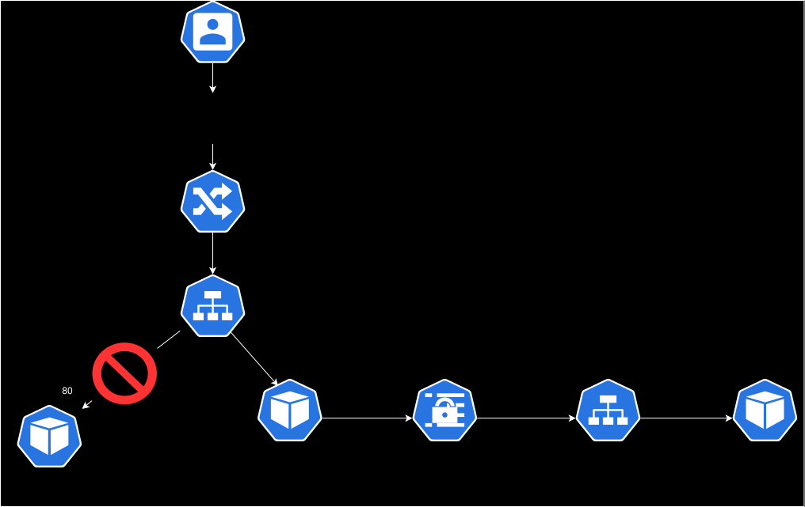

# Kubernetes入門ハンズオン

## 1. はじめに

### 1.1 このハンズオンについて

このハンズオンでは、Kubernetesの基本的なリソースについて学び、簡単なアプリケーションのデプロイを体験します。

このハンズオンは、Kubernetesを扱ったことがない方や、これから学び始めたい方を対象としています。

> KubernetesのPod、Deployment、Service、GatewayAPIの概要を知っており、これらのリソースを用いたアプリケーションの構築ができる方は、次のハンズオンに進むと良いでしょう。

### 1.2 Kubernetesの概要

Kubernetesは、コンテナ化されたアプリケーションを管理・運用するための、ポータブルで拡張性のあるオープンソースプラットフォームです。

Kubernetesが備える機能の一例を以下に示します。このような、アプリケーションの効率的な管理・運用に資する機能が多数備えられています。

* 自動化されたデプロイとロールバック
* スケーリングによる負荷分散
* 複数のノードからなるクラスターのリソースの効率的な利用
* 障害が発生したコンテナの再起動・自己修復
* アプリケーションで使用する機密情報の管理
* ロールベースアクセス管理（RBAC）
* バッチ実行

詳細については、以下の参考文献も参照してください。

* Kubernetesドキュメント/コンセプト/概要
https://kubernetes.io/ja/docs/concepts/overview

### 1.3 事前準備

ハンズオンを始める前に、CLIツールが正常に動作しているか確認します。

クラスターの操作には、Kubernetesプロジェクトが公式に提供するkubectlというCLIツールを使用します。
kubectlは、クラスターに用意された管理用のAPIサーバーにリクエストを送ることで、クラスターをリモートで操作します。

kubectlが正しくセットアップされていないとAPIにリクエストを送ることができず、クラスターの操作ができなくなってしまいます。

まずは、以下のコマンドでkubectlコマンドのバージョンの確認してください。

```sh
kubectl version --client
```

```
# 実行結果
Client Version: v1.34.1
Kustomize Version: v5.7.1
```

続けて、APIにリクエストを送信してみます。以下のコマンドを入力してください。

```sh
kubectl get nodes
```

Nodeの一覧が出力されるはずです。Nodeはコンテナを実際に実行する物理マシンやVMです。表示される3つのNodeが、今回扱うクラスターを形成しています。

```Log
NAME                 STATUS   ROLES           AGE   VERSION
kind-control-plane   Ready    control-plane   88m   v1.34.0
kind-worker          Ready    <none>          88m   v1.34.0
kind-worker2         Ready    <none>          88m   v1.34.0
```

Nodeが表示されない場合は、kubectlの設定（kubeconfig）が正しくない可能性があります。以下のコマンドでkubeconfigを確認します。

```sh
kubectl config get-contexts
```

```
# 実行結果
CURRENT   NAME        CLUSTER     AUTHINFO    NAMESPACE
*         kind-kind   kind-kind   kind-kind   
```

続いて、chapter_kubernetes-introductionにcurrent directoryを移動します。

```sh
cd ~/cnd-handson-infra/chapter_kubernetes-introduction/
```

## 2. アプリケーションのデプロイ

### 2.1. DeploymentをApply

まずは、以下の図に示す、PodとDeploymentからなる簡単なテスト用アプリケーションをデプロイします。



Podは、1つまたは複数のコンテナの組を表すリソースです。「論理的なホスト」と考えることもできます。

DeploymentはPodの管理に用いられるリソースです。Deploymentを用いることで、同じ内容のPodを複数作成したり、Podのバージョンを管理しロールアウト・ロールバックしたりできます。

Kubernetesでは、Manifestと呼ばれるファイルによって各リソースの状態が定義されます。Manifestを作成し、kubectlでAPIに送信することで、リソースを作成できます。

Manifestファイルはyaml形式もしくはjson形式がサポートされています。
今回はyaml形式のManifestを用意していますので、そのManifestを使ってPodをデプロイします。
以下のコマンドを入力してください。

```sh
cd manifests
kubectl apply -f test-deployment.yaml
```

以下のコマンドでDeploymentおよびPodの確認ができます。`test-deployment`という名前のDeploymentと`test-deployment-**********-*****`というPodが作成されていることを確認します。（`*****` には自動で決定された英数字の値が入ります）

```sh
kubectl get deployments,pods
```

### 2.2. ポートフォワードと通信確認

続いて、作成したPodに外部からアクセスできるようにします。
今回はポートフォワードを使いpodにアクセスしていきます。

```sh
kubectl port-forward <Pod名>  8888:80
```

以下のように出力されたら外部からのアクセスが可能となります。ctrl＋Cを押さずにそのままでいてください。

```Log
Forwarding from 127.0.0.1:8888 -> 80
Forwarding from [::1]:8888 -> 80
```

新しくターミナルを開き、以下のコマンドでアクセスしてみましょう。

```sh
curl -I http://localhost:8888
```

成功すると、リターンコード200が返却されるはずです。

動作確認後、ctrl＋Cでポートフォワードを停止します。

### 2.3. Pod削除

続いて、Podを削除してみます。
以下のコマンドを入力してください。

```sh
kubectl delete pod <pod名>
```

Pod名、及び削除されたかどうかは以下で調べることができます。

```sh
kubectl get pods
```

上記の対応では、Podが削除されたものの、新しいPodがすぐに作成されていることがわかります。

Kubernetesはあるべき状態をManifestとして定義します。
`test-deployment.yaml`では、test Deployment配下のPodが1つ存在する状態（`replicas: 1`の部分）をあるべき状態として定義しています。
このケースではPodを削除したことをトリガーにあるべき状態に戻そうと、Deployment（厳密にはDeployment配下のReplicaSetというリソース）が働きかけたことが原因です。

従って、このようなケースでPodを完全に削除したい場合はDeploymentごと削除する必要があります。

まず、以下のコマンドでDeploymentの状態を確認します。

```sh
kubectl get deployments
```

続いて、以下のコマンドで対象PodのDeploymentを削除します。

```sh
kubectl delete deployment test
```

以下のコマンドでDeployment及びPodが削除されたことを確認します。Deploymentが削除されると、その配下のPodも自動で削除されます。

```sh
kubectl get deployments,pods
```


### 2.4 スケーリング

Deployment（厳密にはDeployment配下のReplicaSet）は、指定したReplica数（Podの個数）を維持するために、自動的にPodの作成、削除を行います。

先ほどのManifestにはReplica数1が設定されています。そのため、起動したPodも1つだったはずです。

```Yaml
apiVersion: apps/v1
kind: Deployment
metadata:
  annotations:
    deployment.kubernetes.io/revision: "1"
  labels:
    app: test
  name: test
spec:
  replicas: 1 #ここが1になっている
  selector:
    matchLabels:
      app: test
  template:
    spec:
      restartPolicy: OnFailure
    metadata:
      labels:
        app: test
    spec:
      containers:
      - image: nginx:latest
        name: test
        ports:
        - containerPort: 80
```

以下のようにManifestを修正し、再度Manifestを登録しなおしてみます。

```Yaml
apiVersion: apps/v1
kind: Deployment
metadata:
  annotations:
    deployment.kubernetes.io/revision: "1"
  labels:
    app: test
  name: test
spec:
  replicas: 2 #2に修正
  selector:
    matchLabels:
      app: test
  template:
    spec:
      restartPolicy: OnFailure
    metadata:
      labels:
        app: test
    spec:
      containers:
      - image: nginx:latest
        name: test
        ports:
        - containerPort: 80
```

```sh
kubectl apply -f test-deployment.yaml
```

図のようにPodが2つに増えているはずです。



以下のコマンドで確認します。

```sh
kubectl get pods
```

```Log
# 出力例
NAME                           READY   STATUS    RESTARTS   AGE
test-5cdf547c4f-8z5h9   1/1     Running   0          10s
test-5cdf547c4f-wvzbt   1/1     Running   0          10s
```

Deploymentの `replicas` の値を変えるだけで、簡単にアプリケーションのスケーリングをできることがわかりました。

さらに、ここでは扱いませんが、[HorizontalPodAutoscaler](https://kubernetes.io/ja/docs/concepts/workloads/autoscaling/horizontal-pod-autoscale/)というリソースを併用し、CPUやメモリの使用率やカスタムメトリクスに応じて自動的にスケーリングさせることもできます。

### 2.5. Tips

先ほどまではDeployment Manifestを作成しPodを作成しましたが、簡単なテストを実行したい場合などに手軽にPodを起動したい場合などがあると思います。
以下のようなコマンドを実行すると、ワンライナーでPodの起動までが行えます。

```sh

kubectl run <Pod名> --image=<image名> 

```

また、Manifestを1から書くことが難しい場合は、以下のようにdry-runとyaml出力を組み合わせてファイルに書き込むことでManifestを作成することができます。

```sh

kubectl run <pod名> --image=<image名> --dry-run=client -o yaml > <ファイル名>
```

## 3. Podの外部公開

続いて、Podの外部公開の方法を紹介します。
前回のセッションではPortForwardを使ってPodのアクセスを行いましたが、PortForwardは本格的な運用には不向きです。

本セクション以降はServiceおよびGatewayAPIを用いて外部公開を行います。

### 3.1. Serviceの作成

Serviceリソースは、複数のPodに対応する1つのエンドポイントを提供します。
アプリケーションに対するリクエストをServiceが振り分けることで負荷分散が可能となります。

以下の図のように、test Deployment配下のPodのエンドポイントとなるServiceを作成します。



以下のManifestが配置されていますので、それをapplyしてください。

```Yaml
apiVersion: v1
kind: Service
metadata:
  labels:
    app: test
  name: test-service
spec:
  ports:
  - port: 80
    protocol: TCP
    targetPort: 80
  selector:
    app: test # ラベル`app: test`を持つPodにリクエストを送信する
  type: ClusterIP
```

```sh
kubectl apply -f test-service.yaml
```

Serviceについては以下で確認が可能です。

```sh
kubectl get services
```

```Log
# 出力例
test-service   ClusterIP   10.96.123.57   <none>        80/TCP    16s
```

### 3.2 Gateway API

Gateway APIは、クラスター外からのリクエストをServiceに送信します。
また、ここでは触れませんが、URLやヘッダーなどによるルーティングや、TLSの終端など、トラフィックに関する高度な機能も利用可能です。



Gateway APIを用いて、アプリケーションを外部からアクセスできるようにします。

Serviceリソース同様、予め用意されているManifestを使用します。

※Gateway APIの利用には、GatewayClass、Gateway、HTTPRouteの3つのリソースが必要ですが、GatewayClassとGatewayはすでに準備しておりますので、今回はHTTPRouteのみ作成します。

```Yaml
apiVersion: gateway.networking.k8s.io/v1
kind: HTTPRoute
metadata:
  name: test-httproute
spec:
  parentRefs:
  - name: handson-gateway
  hostnames:
  - "hello-world.example.com"
  rules:
  - matches:
    - path:
        type: PathPrefix
        value: /
    backendRefs:
    - name: test-service
      port: 80
```

```sh
kubectl apply -f test-httproute.yaml 
```

作成したHTTPRouteは以下で確認が可能です。

```sh
kubectl get httproutes
```

```Log
# 出力例
<TODO: 記載>
```

### 3.3. 動作確認

以上で、クラスター外からアプリケーションにアクセスできるようになりました。

ブラウザで以下にアクセス確認を行います。Hello Worldの文字が表示されたら成功です。

```
hello-world.example.com
```

動作確認後、リソースを削除します。

```
kubectl delete httproutes test-httproute
kubectl delete service test-service
kubectl delete deployment test
```

## 4. アプリケーションの更新

このセクションでは、Podの更新方法について紹介します。

### 4.1. Rolling Update

Kubernetesには、コンテナイメージの変更など、Podの内容を更新する際に、サービスに影響が出ないよう段階的に更新の動作を行うRolling Updateという機能があります。

Rolling Updateでは、図の①〜⑤のような流れで、新しいPodの作成と古いPodの削除を少量ずつ繰り返すことで、Podを新しいものに入れ替えていきます。これにより、サービスの停止や性能低下を伴わずにバージョンを新しくできます。



それでは、実際に更新動作を確認していきましょう。
更新するときの処理はstrategyで指定します。デフォルトはRollingUpdateです。
ローリングアップデートの処理をコントロールするためにmaxUnavailableとmaxSurgeを指定することができます。

- minReadySeconds
  新しく作成されたPodが利用可能となるために、最低どれくらいの秒数コンテナーがクラッシュすることなく稼働し続ければよいか
- maxSurge
  理想状態のPod数を超えて作成できる最大のPod数(割合でも設定可)
- maxUnavailable
  更新処理において利用不可となる最大のPod数(割合でも設定可)


今回は4つのReplica数に対してmaxSurgeを25%、つまり1つずつ更新がかかるような設定をしています。
また、Podは作成後直ぐに利用可能になるので、動作イメージをつかみやすくするためにminReadySecondsは10秒に設定しています。

動作確認用のManifestを適用しましょう。

```sh
kubectl apply -f rollout.yaml
```

続いて、ブラウザで以下にアクセスを行います。

```
http://rollout.example.com
```

Pod更新前の状態では、`This app is Blue`の画面が表示がされていると思います。


続いて、先ほどデプロイしたDeploymentに対して、イメージの更新を行います。


その際、Rolling Updateの機能が働き、25%のPod数(1個)ずつ追加されていく様子が確認できます。

```sh
# 適用
kubectl set image deployment/rollout rollout-app=ghcr.io/cloudnativedaysjp/green-app:1.0
```

```sh
# 確認
kubectl rollout status deployment 
kubectl rollout history deployment 
kubectl get pods
kubectl get deployments
```

更新後、ブラウザで再度以下にアクセスを行うと`This app is Green`の表示に更新されていることが確認できます。

```
http://rollout.example.com
```

尚、ロールバックを行う場合は以下のコマンドで実行可能です。

```sh
kubectl rollout undo deployment rollout
```

動作確認実施後、リソースの削除を行います。

```sh
kubectl delete deployment rollout
kubectl delete service rollout-service
kubectl delete ingress rollout-ingress
```

### 4.2 Blue-Green Deployment

古い環境を残したまま新しい環境を用意し、ルーティングなどによってトラフィックを制御し、ダウンタイム無しで環境を切り替える手法です。

今回は、図のようにGatewayAPIのルーティングを利用し、Blue-Green Deploymentを実現します。




```Yaml
apiVersion: gateway.networking.k8s.io/v1
kind: HTTPRoute
metadata:
  name: blue-green
spec:
  parentRefs:
  - name: handson-gateway
  hostnames:
  - "blue-green.example.com"
  rules:
  - matches:
    - path:
        type: PathPrefix
        value: /
    backendRefs:
    - name: blue-service
      port: 80
      weight: 100 # リクエストの100%をBlue（旧環境）に送信
    - name: green-service
      port: 80
      weight: 0 # リクエストの0%を新環境（Green）に送信
```

まずは、対象のManifestを適用します。

```sh
kubectl apply -f blue-green.yaml
```

続いて、Pod,Service,HTTPRouteがそれぞれデプロイされているか確認を行います。

```sh
kubectl get pods,services,httproutes
```

それぞれのリソースが正常に動作していることが確認できたら、ブラウザからアクセスしてみます。

まだ切り替え前なので、`weight`パラメータで、すべてのリクエストをBlue（旧環境）に送信するよう設定しています。そのため、Blue Appが表示されるはずです。

```
http://blue-green.example.com にアクセス→ Blue App
```

それでは、新環境に切り替えてみましょう。`weight`パラメータを変更し、すべてのリクエストをGreen（新環境）に送信するよう設定します。

```Yaml
apiVersion: gateway.networking.k8s.io/v1
kind: HTTPRoute
metadata:
  name: blue-green
spec:
  parentRefs:
  - name: handson-gateway
  hostnames:
  - "blue-green.example.com"
  rules:
  - matches:
    - path:
        type: PathPrefix
        value: /
    backendRefs:
    - name: blue-service
      port: 80
      weight: 0 # リクエストの0%をBlue（旧環境）に送信
    - name: green-service
      port: 80
      weight: 100 # リクエストの100%を新環境（Green）に送信
```

Manifestを適用します。

```sh
kubectl apply -f blue-green.yaml
```

これで新環境への切り替えが完了しました。ブラウザからアクセスすると、Green Appが表示されるはずです。

```
http://blue-green.example.com にアクセス→ Green App
```

もし、新環境に不具合が見つかっても、`weight`パラメータを元に戻して再度applyするだけで、簡単に切り戻しできます。

さらに、`weight`パラメータを巧みに操作することで、以下のような応用も可能です。
* weightパラメータを50:50に設定し、A/Bテストを行う
* 最初はごく僅かなリクエストのみを新環境に送信。徐々に新環境に送信するリクエストの割合を増加させる。新環境に不具合があっても、影響を受けるユーザーの数を抑えられる（カナリアリリースと呼ばれます）

動作確認実施後、リソースの削除を行います。

```sh
kubectl delete -f blue-green.yaml
```

## 5. キーと値のペアをコンテナに渡す

ConfigMapやSecretは、キーと値のペアからなるデータを保存するために使用されるリソースです。

ConfigMapやSecretのデータは、ファイルとしてコンテナにマウントしたり、環境変数としてコンテナから参照したりすることができます。環境固有の設定などをコンテナイメージから分離できるため、アプリケーションを簡単に移植できるようになります。

### 5.1 ConfigMap

ConfigMapは機密性のないデータを保存するために使用されます。

今回は`CND ConfigMap Handson`というHTML形式のデータをConfigMapに保存し、Podにマウントさせています。
クライアントからのリクエストはマウントされたConfigMapのHTMLデータを参照するため、`CND ConfigMap Handson`という文字列が返却されるはずです。

まずは、ConfigMapを作成します。

```sh
kubectl apply -f handson-configmap.yaml
```

続いてPodを作成します。

```sh
kubectl apply -f configmap-pod.yaml
```

次に、PodにアクセスするためIPアドレスを調べます。以下のコマンドでPodに紐づくIPアドレスが判ります。

```sh
kubectl get pods -o wide
```

最後にテンポラリのPodを作成し、curlでアクセスを試みます。
`CND ConfigMap Handson`という文字列が返却されると成功です。

```sh
kubectl run tmp --restart=Never --rm -i --image=nginx:alpine -- curl <PodのIPアドレス>
```

動作確認後、リソースを削除します。

```sh
kubectl delete pod configmap-pod
kubectl delete configmap handson-configmap
```

### 5.2 Secret

Secretは、パスワードやアクセスキーなどの機密データで利用します。

なお、Secretのデータは、デフォルトではbase64でエンコードされた状態で管理され、暗号化されません。本ハンズオンでは触れませんが、暗号化の設定は別途行う必要があります。

今回はユーザー名とパスワードをSecretに保存し、環境変数としてコンテナに渡します。

まずは、Secretを作成します。

```sh
kubectl apply -f handson-secret.yaml
```

続いてPodを作成します。

```sh
kubectl apply -f secret-pod.yaml
```

次に、Pod内にログインし、Secretで指定された環境変数が設定されていることを確認しましょう。

```sh
kubectl exec secret-pod -c nginx -it -- bash
echo $USERNAME
echo $PASSWORD
```

動作確認後、リソースを削除します。

```sh
kubectl delete pod secret-pod
kubectl delete secret handson-secret
```

## 6. トラブルシュート

セクションの最後に、簡単なWebアプリケーションを使ったトラブルシュートに挑戦してみましょう。

`cnd-web.yaml` を修正してください。
構成図右下にあるcnd-web-appに接続し、適切なWebページを表示させることがゴールです。



> [!NOTE]
> - 動作確認は、ブラウザから以下のURLにアクセスすることで行います。
>   - http://cnd-web.example.com
> - リソースの更新後もWeb画面の表示が変わらない場合があります。1-2分待ってからブラウザのリフレッシュを行なってください。
> - 改修箇所は1箇所ではない可能性があります。また、構成図とエラーメッセージがヒントになる場合があります。


以下のコマンドでアプリのデプロイを行なってください。
```sh
kubectl apply -f cnd-web.yaml
```

動作確認後、リソースを削除します。

```sh
kubectl delete -f cnd-web.yaml
```

## 7. 最後に

このハンズオンでは、Kubernetesの基本的なリソースの概要や使用方法について学びました。また、Kubernetesを用いて、コンテナ化されたアプリケーションのデプロイやスケーリング、バージョンアップが簡単にできることを学びました。

本ハンズオンで、Kubernetesに少しでも興味を持っていただけましたら幸いでございます。

最も、これらはKubernetesの世界のほんの序章にすぎません。

[chapter_kubernetes-overview](../chapter_kubernetes-overview/)ではストレージの扱いやセキュリティ・RBACに関する機能、バッチ処理など、Kubernetesの機能をさらに探ります。

また、[chapter_troubleshoot](../chapter_troubleshoot/)では、今回学んだリソースをさらに深掘りし、Kubernetesクラスターの運用を体験します。

さらに、Kubernetesは拡張性が高く、さまざまな拡張ツールを導入することで、より高度な運用が可能です。そのようなツールに関するハンズオンも多数ご用意しています。

この後も、Kubernetesの世界を存分にお楽しみください。