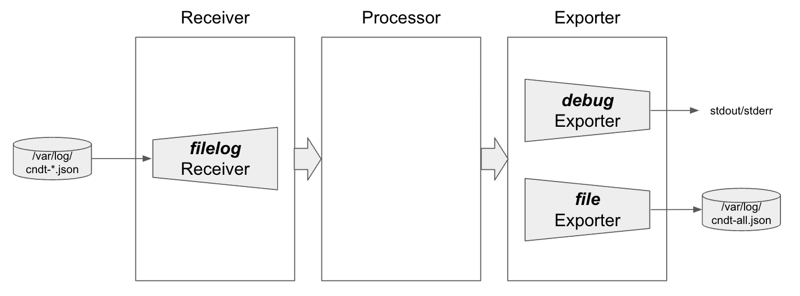
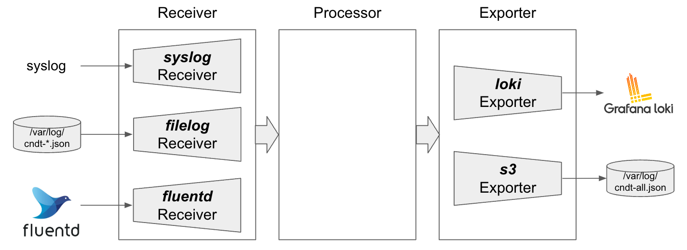

# OpenTelemetry入門ハンズオン

## 概要

OpenTelemetryは、分散システムにおける観測データを収集するためのツール群とAPIを提供するオープンソースプロジェクトです。その目的は、アプリケーションのパフォーマンスと動作を理解し、問題を特定して解決するためのデータを提供することです。OpenTelemetryは、トレーシング、メトリクス、ログといった観測データの収集を自動化し、一貫性のある方法でこれらのデータを分析するための標準化された手段を提供します。これにより、開発者はアプリケーションのパフォーマンスを監視し、問題を特定して解決するための洞察を得ることができます。

OpenTelemetryプロジェクトの代表的なプロダクトは以下のとおりです。

* OpenTelemetry SDK
  * アプリケーションにトレースデータなどを公開するためのライブラリ
  * TraceやLogsなどに対応している
* OpenTelemetry Protocol（OTLP）
  * メトリクス、ログ、トレースなどのテレメトリを転送するためのプロトコル
  * アプリケーションにインストルメンテーションされたSDK、各種エージェント、OpenTelemetry Collectorとの間でテレメトリを転送するために利用
* OpenTelemetry Collector
  * メトリクス、ログ、トレースなどの各種テレメトリの送受信やデータ処理を行うコンポーネント
  * さまざまなプロバイダーに対応するためにプラグイン方式を採用している

このハンズオンでは、OpenTelemetry Collectorでメトリクス・ログ・トレースを扱う方法と、OpenTelemetry SDKを用いて分散トレースを行う方法について実際に体験します。

### OpenTelemetry Collectorのコンポーネント

OpenTelemetry Collectorは、内部的には4つのコンポーネントで構成されています。

* Receiver
  * データを受け付けるためのコンポーネント
  * プッシュベース、プルベースの両方に対応しており、さまざまなデータソースに対応
* Exporter
  * データを外部へ送信するコンポーネント
  * プッシュベース、プルベースの両方に対応しており、さまざまなデータソースに対応
* Processor
  * データを `Receiver` で受信してから、`Exporter` で送信するまでに処理を行うコンポーネント
* Connector
  * `Exporter` と `Receiver` の両方の役割をもち、パイプラインを接続するコンポーネント
  * あるデータ型からあるデータ型へと変換なども行うことが可能

### CoreプラグインとContribプラグイン

これらのコンポーネントはプラガブルな仕組みになっています。
たとえば、`Receiver` ではPrometheusからメトリクスデータを取得するプラグイン・ローカルのJSONファイルからログデータを取得するプラグインなどがあったり、`Exporter` ではPrometheusのRemote Write Endpointにメトリクスデータを出力するプラグイン・Lokiにログデータを出力するプラグイン・Datadogにデータを出力するプラグインなどがあります。

多岐にわたるプラグインは、主要なプラグインだけを含んでいるCoreディストリビューションと、さまざまなプラグインを含んでいるContribディストリビューションが用意されています。他にも、各ベンダーが提供しているカスタムディストリビューションも存在します。

* 「Core ディストリビューション（open-telemetry/opentelemetry-collector）」
* 「Contrib ディストリビューション（open-telemetry/opentelemetry-collector-contrib）」

`opentelemetry-collector-contrib` はさまざまなプラグインが含まれておりバイナリサイズが大きいため、必要があれば自前でビルドすることが推奨されています。

各種コンポーネントで利用可能なプラグインは下記のGitリポジトリで管理されています。

* Receiver
  * [Core Plugin](https://github.com/open-telemetry/opentelemetry-collector/tree/main/receiver)
  * [Contrib Plugin](https://github.com/open-telemetry/opentelemetry-collector-contrib/tree/main/receiver)
* Exporter
  * [Core Plugin](https://github.com/open-telemetry/opentelemetry-collector/tree/main/exporter)
  * [Contrib Plugin](https://github.com/open-telemetry/opentelemetry-collector-contrib/tree/main/exporter)
* Processor
  * [Core Plugin](https://github.com/open-telemetry/opentelemetry-collector/tree/main/processor)
  * [Contrib Plugin](https://github.com/open-telemetry/opentelemetry-collector-contrib/tree/main/processor)
* Connector
  * [Core Plugin](https://github.com/open-telemetry/opentelemetry-collector/tree/main/connector)
  * [Contrib Plugin](https://github.com/open-telemetry/opentelemetry-collector-contrib/tree/main/connector)


## セットアップ

### OpenTelemetry Operatorのインストール

helmfileを使用してOpenTelemetry Operatorをインストールします。
OpenTelemetry Operatorをインストールすることで、OpenTelemetry CollectorなどをKubernetesのリソースで管理できます。
ValidatingWebhookの兼ね合いで`helmfile sync`が失敗することがあるため、失敗した場合は再度実行してください。

```sh
helmfile sync -f helm/helmfile.yaml
```

`monitoring` NamespaceにデプロイされたOpenTelemetry OperatorのPodが起動していれば成功です。

```sh
kubectl -n monitoring get pods
```
```sh
# 実行結果
NAME                                      READY   STATUS    RESTARTS   AGE
opentelemetry-operator-677b4d8655-6q5j5   1/1     Running   0          20h
```

## OpenTelemetryCollectorリソースによるCollectorのデプロイと管理

OpenTelemetry Collectorは、メトリクス・ログ・トレースなどのテレメトリの送受信やデータ処理を行うことができるコンポーネントです。
CollectorはDeploymentやDaemonSetとしてデプロイし、その上でさまざまなデータソースからデータを取得し、任意の処理を行った上で、さまざまなデータソースに出力します。

OpenTelemetry Collectorは、こうしたデータ処理のパイプライン定義を設定ファイルで記述します。
下記は設定ファイルの例です。
設定ファイルは主に、下記の4つから構成されています。

* receivers
* processors
* exporters
* service

`receivers` `processors` `exporters` には、それぞれ利用するプラグインの設定を書いていきます。
今回の例だと `hostmetrics` receiver・`debug` exporter・`prometheusremotewrite` exporterの3種類を利用するために設定を行っています。
設定したreceiverなどは、service.pipelinesのところで利用する設定をします。
receiverやexporterによっては、メトリクス・ログ・トレースなどの複数テレメトリをサポートしている場合もあるため、`service.pipelines.metrics`や`service.pipelines.logs`のように、どのテレメトリに対して利用するのかを指定する必要があります。
なお、対応していないテレメトリに対してプラグインを利用する設定を書いた場合、OpenTelemetry Collectorが起動しません。

```yaml
receivers:
  hostmetrics:
    collection_interval: 30s
    scrapers:
      cpu: {}
      memory: {}

processors: {}

exporters:
  debug: {}
  prometheusremotewrite:
    endpoint: "https:/kube-prometheus-stack-prometheus.prometheus.svc:8080/prometheus/remote/write"
    external_labels:
      oteltest: cndhandson

service:
  pipelines:
    metrics:
      receivers: [hostmetrics]
      processors: []
      exporters: [debug, prometheusremotewrite]
```


OpenTelemetryの設定ファイルに関しては、[公式サイト](https://opentelemetry.io/docs/collector/configuration/)に情報がまとまっています。また、利用可能なプラグインについては、先ほど「CoreプラグインとContribプラグイン」で紹介しているのでそちらを参照してください。


## Log をOpenTelemetry Collectorで管理する例

最初にログをOpenTelemetry Collectorで扱う例を紹介します。
ログを取り扱う場合は、ちょうど `Fluentd`や`Fluent Bit`と同じようなものだと想像してもらうとイメージしやすいかもしれません。

今回は、`/var/log`ディレクトリにある`cndt-*.json`にマッチするログを`filelog` Receiverで取得し、JSON形式でパースした後、デバッグログとして出力しながら、`file` Exporterでまとめてファイルとしても出力する簡単な例で試してみます。



OpenTelemetry Collectorをデプロイするには、OpenTelemetryCollectorリソースをKubernetesに登録します。
これにより、OpenTelemetry Operatorが自動的にDeploymentやDaemonSetを作成します。

今回はログエージェントとして動作させる想定なため、`.spec.mode`にはdaemonsetを指定し、DaemonSetとして起動します。また、起動するPodにはホスト上の`/var/log`をマウントしておきたいので、`volumeMounts`に関する設定もしておきます。
最後に、先ほど紹介したOpenTelemetry Collectorの設定を`.spec.config`に行っておきます。

```yaml
apiVersion: opentelemetry.io/v1beta1
kind: OpenTelemetryCollector
metadata:
  name: log-collector
spec:
  mode: "daemonset"
  volumeMounts:
    - name:  host-log-volumes
      mountPath: /var/log
  volumes:
    - name: host-log-volumes
      hostPath:
        path: /tmp
  config:
    receivers:
      filelog:
        include: [ /var/log/cndt-*.json ]
        operators:
        - type: json_parser

    exporters:
      debug:
        verbosity: detailed
      file:
        path: /var/log/all.json
        rotation:
          max_megabytes: 1

    service:
      pipelines:
        logs:
          receivers: [filelog]
          processors: []
          exporters: [file, debug]
```

OpenTelemetryCollectorリソースをデプロイすると、自動的にDaemonSetとPodが起動していることがわかります。

```sh
kubectl apply -f manifests/log-collector.yaml
```
```sh
# 実行結果
opentelemetrycollector/log-collector created
```

```sh
kubectl get opentelemetrycollector
```
```sh
# 実行結果
NAME            MODE        VERSION   READY   AGE   IMAGE                                          MANAGEMENT
log-collector   daemonset   0.131.1   2/2     46s   otel/opentelemetry-collector-contrib:0.131.1   managed
```

```sh
kubectl get daemonsets,pods -l app.kubernetes.io/name=log-collector-collector
```
```sh
# 実行結果
NAME                                     DESIRED   CURRENT   READY   UP-TO-DATE   AVAILABLE   NODE SELECTOR   AGE
daemonset.apps/log-collector-collector   2         2         2       2            2           <none>          18h

NAME                                READY   STATUS    RESTARTS   AGE
pod/log-collector-collector-pwl6p   1/1     Running   0          18h
pod/log-collector-collector-gsd8a   1/1     Running   0          18h
```

次に、実際にログをホスト上のディレクトリに書き込んでみましょう。
今回はホスト上の`/var/log/cndt-*.json`のログをまとめてくれるようになっているため、試しに下記の通り書き込んでみます。

```bash
docker exec -it kind-worker sh -c "echo '{\"key1\": \"value1\", \"key2\": \"value2\"}' >> /tmp/cndt-1.json"
```

その後、`file` Exporterによって出力されたファイルを見てみると、確かにReceiverで受け取ったログがExporterで出力されていることが確認できます。

```sh
docker exec -it kind-worker sh -c "cat /tmp/all.json  | jq ."
```

```json
# 実行結果
{
  "resourceLogs": [
    {
      "resource": {},
      "scopeLogs": [
        {
          "scope": {},
          "logRecords": [
            {
              "observedTimeUnixNano": "1698769057617769597",
              "body": {
                "stringValue": "{\"key1\": \"value1\", \"key2\": \"value2\"}"
              },
              "attributes": [
                {
                  "key": "key1",
                  "value": {
                    "stringValue": "value1"
                  }
                }
                {
                  "key": "key2",
                  "value": {
                    "stringValue": "value2"
                  }
                },
                {
                  "key": "log.file.name",
                  "value": {
                    "stringValue": "cndt-1.json"
                  }
                },
              ],
              "traceId": "",
              "spanId": ""
            }
          ]
        }
      ]
    }
  ]
}
```

`/tmp/cndt-1.json`など、正規表現にマッチするさまざまなファイル名に対してログを出力して`/tmp/all.json`が書き換わることも確認してみてください。
また、余裕がある方は各種Receiver・ExporterのDocsを確認し、さまざまな処理やオプションを試してみてください。

* 利用しているReceiver
  * [filelogreceiver](https://github.com/open-telemetry/opentelemetry-collector-contrib/tree/main/receiver/filelogreceiver)
* 利用しているExporter
  * [debugexporter](https://github.com/open-telemetry/opentelemetry-collector/tree/main/exporter/debugexporter)
  * [fileexporter](https://github.com/open-telemetry/opentelemetry-collector-contrib/tree/main/exporter/fileexporter)

今回は簡単な例でしたが、syslogやFluentdなどさまざまなデータを受け取ってフィルタリングやラベルの追加処理を実施後、Lokiに転送しつつ、S3にgzip圧縮して送るといった複雑なユースケースにも対応できます。


