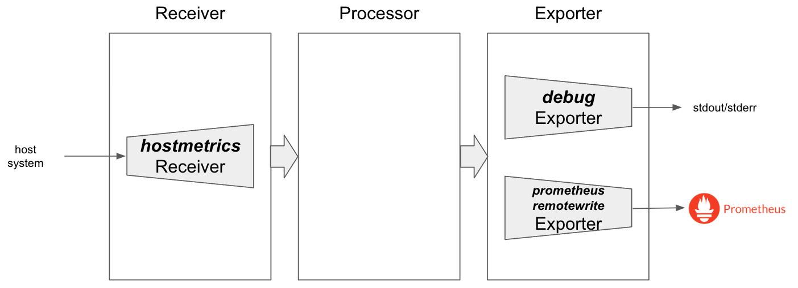
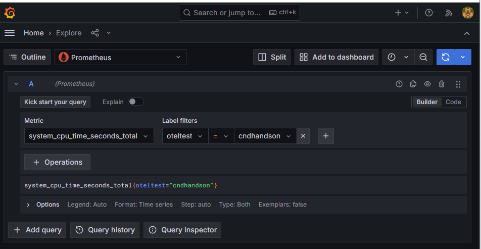
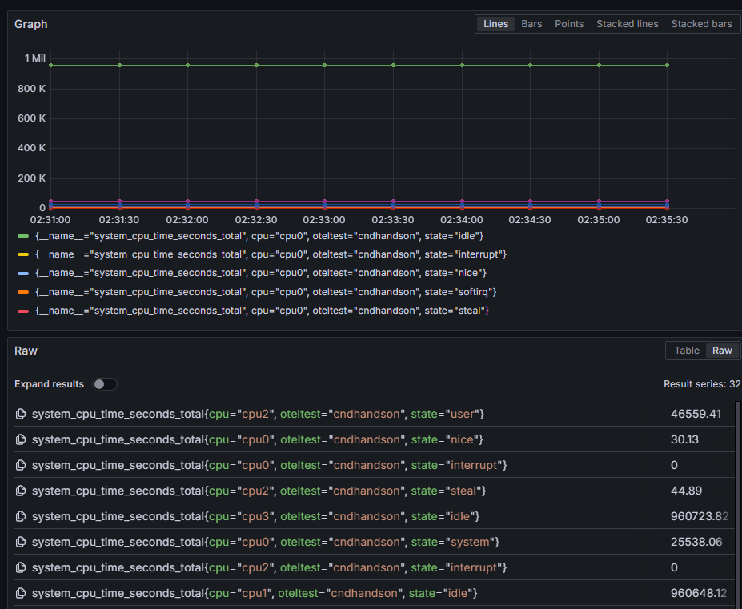
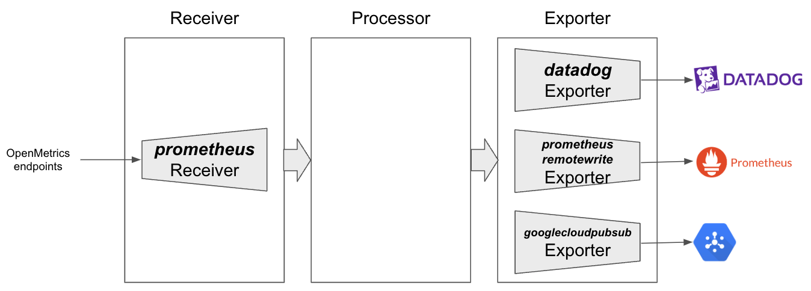
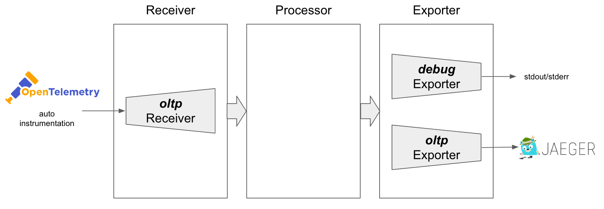
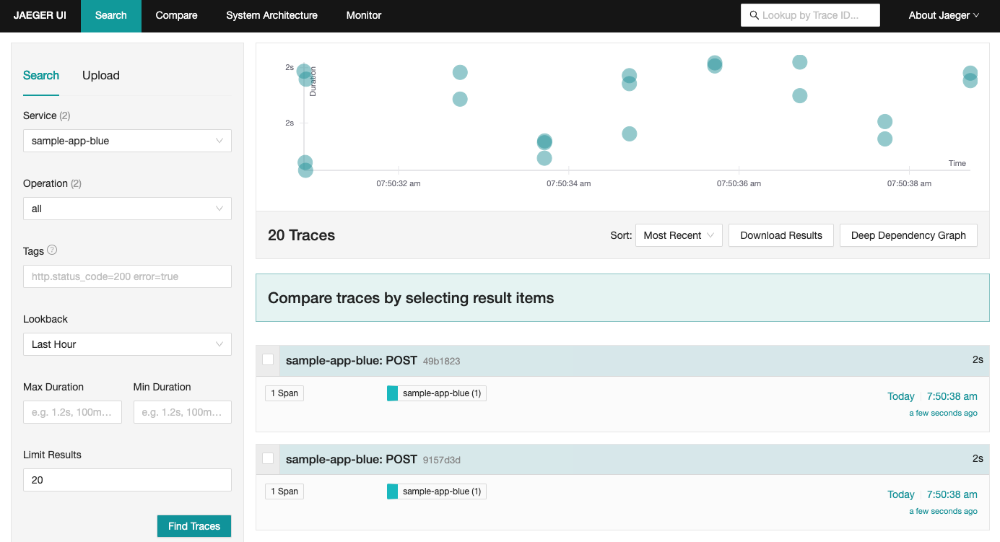
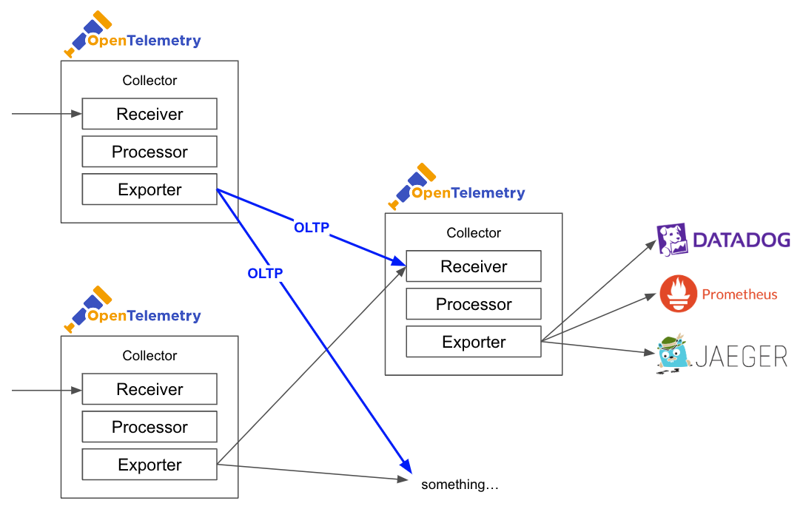

# OpenTelemetry概論ハンズオン

## Metrics をOpenTelemetryで管理する例

次にメトリクスをOpenTelemetry Collectorで扱う例を紹介します。

今回は、`hostmetrics` Receiverを利用し、ホスト上のCPUやメモリに関するデータを取得し、そのデータを`prometheusremotewrite` Exporterを利用してPrometheusに対してRemote Writeで書き込みを行ってみます。



ログの時と同様に、OpenTelemetryCollectorリソースを利用してKubernetesにデプロイします。
最後に、OpenTelemetry Collectorの設定を`.spec.config`に行っておきます。

```yaml
apiVersion: opentelemetry.io/v1beta1
kind: OpenTelemetryCollector
metadata:
  name: metrics-collector
spec:
  mode: "daemonset"
  config:
    receivers:
      hostmetrics:
        collection_interval: 30s
        scrapers:
          cpu: {}
          memory: {}

    processors: {}

    exporters:
      debug: {}
      prometheusremotewrite:
        endpoint: http://kube-prometheus-stack-prometheus.prometheus:9090/api/v1/write
        external_labels:
          oteltest: cndhandson

    service:
      pipelines:
        metrics:
          receivers: [hostmetrics]
          processors: []
          exporters: [debug, prometheusremotewrite]
```

OpenTelemetryCollectorリソースをデプロイすると、自動的にDaemonSetとPodが起動していることがわかります。

```sh
kubectl apply -f manifests/metrics-collector.yaml
```
```sh
# 実行結果
opentelemetrycollector/metrics-collector created
```

```sh
kubectl get opentelemetrycollector metrics-collector
```
```sh
# 実行結果
NAME                MODE        VERSION   READY   AGE   IMAGE                                          MANAGEMENT
metrics-collector   daemonset   0.131.1   2/2     4s    otel/opentelemetry-collector-contrib:0.131.1   managed
```

```sh
kubectl get daemonsets,pods -l app.kubernetes.io/name=metrics-collector-collector
```
```sh
# 実行結果
NAME                                         DESIRED   CURRENT   READY   UP-TO-DATE   AVAILABLE   NODE SELECTOR   AGE
daemonset.apps/metrics-collector-collector   2         2         2       2            2           <none>          3m24s

NAME                                    READY   STATUS    RESTARTS   AGE
pod/metrics-collector-collector-8dvss   2/2     Running   0          3m24s
pod/metrics-collector-collector-mzd9j   2/2     Running   0          3m24s
```

まずは`debug` Exporterが出力しているログを確認してみます。
下記のようにログを確認すると、2つのメトリクスで合計166個のデータポイントが取得されていることが確認できます。
メトリクス名まで確認したい場合には、OpenTelemetryCollectorの`spec.config`の`exporters.debug.verbosity`を`detailed`に設定することで確認できます。

```sh
kubectl logs -l app.kubernetes.io/name=metrics-collector-collector -f
```
```sh
# 実行結果
2023-11-12T20:08:46.171Z        info    MetricsExporter {"kind": "exporter", "data_type": "metrics", "name": "debug", "resource metrics": 2, "metrics": 2, "data points": 166}
2023-11-12T20:09:16.171Z        info    MetricsExporter {"kind": "exporter", "data_type": "metrics", "name": "debug", "resource metrics": 2, "metrics": 2, "data points": 166}
2023-11-12T20:09:46.171Z        info    MetricsExporter {"kind": "exporter", "data_type": "metrics", "name": "debug", "resource metrics": 2, "metrics": 2, "data points": 166}
...
```

次に、実際にGrafana上からメトリクスを確認してみましょう。
`http://grafana.example.com/explore` に接続し、`system_cpu_time_seconds_total`のメトリクスを確認してみます。
今回利用している`hostmetrics` Receiverで取得しているメトリクスには[Host Metrics Receiver](https://github.com/open-telemetry/opentelemetry-collector-contrib/blob/main/receiver/hostmetricsreceiver/internal/scraper/cpuscraper/documentation.md)のページから確認できます。
`exporters.prometheusremotewrite.external_labels`の設定で`oteltest=cndhandson`のラベルを付与しているため、ラベルの指定をすることでOpenTelemetry Colelctorが出力したメトリクスのみに絞ることも可能です。



実際に出力されたメトリクスを確認すると、CPUの使用内訳（state）やユニット（cpu）などのラベルが付与された状態でメトリクスが書き込まれていることが確認できます。



* 利用しているReceiver
  * [hostmetricsreceiver](https://github.com/open-telemetry/opentelemetry-collector-contrib/blob/main/receiver/hostmetricsreceiver)
* 利用しているExporter
  * [debugexporter](https://github.com/open-telemetry/opentelemetry-collector/tree/main/exporter/debugexporter)
  * [prometheusremotewrite](https://github.com/open-telemetry/opentelemetry-collector-contrib/tree/main/exporter/prometheusremotewriteexporter)

今回は簡単な例でしたが、[OpenMetrics](https://github.com/prometheus/OpenMetrics/tree/main)互換のエンドポイントからデータを取得し、Prometheus・Datadog・Google Cloud Pub/Subにデータをそれぞれ転送するといったユースケースにも対応できます。
また、ScrapeしてRemote Writeするといったユースケースでは、Prometheusの代替にするために`prometheusreceiver`といったプラグインを利用することもできます。




## Trace をOpenTelemetryで管理する例

TraceをOpenTelemetryで管理するハンズオンを進める前に、TraceバックエンドであるJaegerをインストールします。
Jaeger Operator自体はすでにインストールしているため、`Jaeger`リソースを利用してデプロイします。
今回は簡略化のために、永続化はしない設定を利用します。

```yaml
apiVersion: jaegertracing.io/v1
kind: Jaeger
metadata:
  name: jaeger
  namespace: jaeger
spec:
  strategy: allInOne
  allInOne:
    options:
      log-level: debug
  storage:
    type: memory
    options:
      memory:
        max-traces: 100000
  ingress:
    enabled: true
    hosts:
    - jaeger.example.com
    ingressClassName: nginx
    annotations:
      nginx.ingress.kubernetes.io/ssl-redirect: "false"
```

実際にJaegerをデプロイします。

```bash
kubectl apply -f manifests/jaeger.yaml
```

デプロイされたJaegerリソースを確認し、ステータスがRunningなことを確認してください。

```sh
kubectl -n jaeger get jaeger
```

```sh
# 実行結果
NAME     STATUS    VERSION   STRATEGY   STORAGE   AGE
jaeger   Running   1.61.0    allinone   memory    11s
```

デプロイされたJaegerのUIは、`http://jaeger.example.com/search`から確認できます。


今回は、`otlp` Receiverを利用し、OpenTelemetry Protocol（OTLP）を利用してトレースデータを受け取ります。そしてそのデータを`otlp` Exporterを利用してJaegerに対して保存、`debug` Exporterを利用して標準出力にもデバッグログを出力します。
Jaegerは以前までは`jaeger`プロトコルを利用していましたが、最近はOTLPにネイティブ対応しています。




ログの時と同様に、OpenTelemetryCollectorリソースを利用してKubernetesにデプロイします。
取得したトレースデータをデプロイした jaeger リソースに送ります。`.spec.mode`にはdeploymentを指定し起動します。
最後に、OpenTelemetry Collectorの設定を`.spec.config`に行っておきます。

```yaml
apiVersion: opentelemetry.io/v1beta1
kind: OpenTelemetryCollector
metadata:
  name: trace-collector
spec:
  mode: "deployment"
  config:
    receivers:
      otlp:
        protocols:
          http: {}

    processors: {}

    exporters:
      debug: {}
      otlp:
        endpoint: jaeger-collector.jaeger:4317
        tls:
          insecure: true

    service:
      pipelines:
        traces:
          receivers: [otlp]
          processors: []
          exporters: [debug, otlp]
```

OpenTelemetryCollectorリソースをデプロイすると、自動的にDeploymentとPodが起動していることがわかります。
また、OTLPを受け付ける口として、Serviceも作成されています。

```sh
kubectl apply -f manifests/trace-collector.yaml
```
```sh
# 実行結果
opentelemetrycollector.opentelemetry.io/trace-collector created
```

```sh
kubectl get opentelemetrycollector trace-collector
```
```sh
# 実行結果
NAME              MODE         VERSION   READY   AGE   IMAGE                                          MANAGEMENT
trace-collector   deployment   0.131.1   1/1     5s    otel/opentelemetry-collector-contrib:0.131.1   managed
```
```sh
kubectl get deployments,pods,services -l app.kubernetes.io/name=trace-collector-collector
```
```sh
# 実行結果
NAME                                        READY   UP-TO-DATE   AVAILABLE   AGE
deployment.apps/trace-collector-collector   1/1     1            1           10m

NAME                                             READY   STATUS    RESTARTS   AGE
pod/trace-collector-collector-5bbc5d7c47-jtscf   1/1    Running   0          88s

NAME                                         TYPE        CLUSTER-IP      EXTERNAL-IP   PORT(S)    AGE
service/trace-collector-collector            ClusterIP   10.96.172.252   <none>        4318/TCP   10m
service/trace-collector-collector-headless   ClusterIP   None            <none>        4318/TCP   10m
```


OpenTelemetry Operatorには、各種アプリケーションのトレースデータを自動インスツルメンテーションするための`Instrumentation`リソースが用意されています。
トレースデータを計装する場合には、[SDKを利用してアプリケーションに手動インスツルメンテーション](https://opentelemetry.io/docs/instrumentation/)するか、[サイドカーとしてコンテナをデプロイして自動インスツルメンテーション](https://opentelemetry.io/docs/kubernetes/operator/automatic/)するかの2通りの方法があります。
今回は、アプリケーションに手を加えなくて利用可能な自動インスツルメンテーションを利用します。

自動インスツルメンテーションを行う場合には、`Instrumentation`リソースで設定を行います。今回はデータを取得し、先ほど作成したJaegerに転送するOpenTelemetry CollectorのOTLP用のエンドポイント `trace-collector-collector.default:4318` に対してデータを転送する設定を行います。

```yaml
apiVersion: opentelemetry.io/v1alpha1
kind: Instrumentation
metadata:
  name: go-instrumentation
  namespace: handson
spec:
  exporter:
    endpoint: http://trace-collector-collector.default:4318
  propagators:
    - tracecontext
    - baggage
  sampler:
    type: parentbased_traceidratio
    argument: "1"
```

```shell
kubectl apply -f manifests/go-instrumentation.yaml
```

自動インスツルメンテーションを利用するには、Podのアノテーションに`instrumentation.opentelemetry.io/inject-go`などの言語ごとの有効化設定を行います。
なお、Goの場合にはeBPFを利用して計装するために、追加で実行しているバイナリをアノテーションで指定する必要があります。
今回の例ではrootディレクトリ直下にある`/rollouts-demo`を実行しているため、下記のような指定をする必要があります。

```yaml
apiVersion: apps/v1
kind: Deployment
metadata:
  name: handson-blue
  namespace: handson
spec:
  template:
    metadata:
      annotations:
        instrumentation.opentelemetry.io/inject-go: go-instrumentation
        instrumentation.opentelemetry.io/otel-go-auto-target-exe: "/rollouts-demo"
    spec: {...}
```

今回はすでにデプロイされている`handson-blue` Deploymentに対して設定を行います。kubectl patchコマンドを利用してこれらのアノテーションを付与します。

```shell
kubectl -n handson patch deployment handson-blue -p '{"spec":{"template":{"metadata":{"annotations":{"instrumentation.opentelemetry.io/inject-go": "go-instrumentation"}}}}}'
kubectl -n handson patch deployment handson-blue -p '{"spec":{"template":{"metadata":{"annotations":{"instrumentation.opentelemetry.io/otel-go-auto-target-exe": "/rollouts-demo"}}}}}'
```

作成されたPodを確認すると、Podにサイドカーとして`opentelemetry-auto-instrumentation`コンテナーが含まれた形で作成されていることが確認できます。

```bash
kubectl -n handson get pods
```
```bash
# 実行結果
NAME                             READY   STATUS   RESTARTS   AGE
handson-blue-5b6445bcfc-vdmwm    2/2     Ready    0          30s
```


次に、実際にJaeger上からメトリクスを確認してみましょう。
まず、`http://app.example.com/` に接続し、一定量のトレースデータを出力します。
`http://jaeger.example.com/search` に接続し、Service名に`handson-blue`を指定してみると、トレースデータが確認できます。
今回は複雑なマイクロサービスではないため、シンプルな表示になっていますが、サービス間の通信がある場合はもう少し複雑なトレースデータを確認できます。



最後にこの章でアプリケーションに加えた変更をクリーンアップしておきます。

```shell
kubectl -n handson patch deployment handson-blue -p '{"spec":{"template":{"metadata":{"annotations":{"instrumentation.opentelemetry.io/inject-go": null}}}}}'
kubectl -n handson patch deployment handson-blue -p '{"spec":{"template":{"metadata":{"annotations":{"instrumentation.opentelemetry.io/otel-go-auto-target-exe": null}}}}}'
```

* 利用しているReceiver
  * [otlp](https://github.com/open-telemetry/opentelemetry-collector/blob/main/receiver/otlpreceiver)
* 利用しているExporter
  * [debugexporter](https://github.com/open-telemetry/opentelemetry-collector/tree/main/exporter/debugexporter)
  * [otlp](https://github.com/open-telemetry/opentelemetry-collector/tree/main/exporter/otlpexporter)


## 中央集権的にデータを扱う

OpenTelemetryでは、OpenTelemetry Protocol（OTLP）を利用して、OpenTelemetry CollectorからOpenTelemetry Collectorへテレメトリデータを転送することもできます。
複数のノードからデータを取得し、サンプリングするAggregator層を挟むなど、処理を中継させたりすることなども可能です。



## 推奨される Processor

今回の例ではProcessorは利用しませんでしたが、Processorも非常に重要なコンポーネントの1つです。
たとえば、大規模な環境で多くのテレメトリデータが出力される場合、それらのデータを適切に処理するにはProcessorが必要不可欠です。
Processorではメモリ制限・サンプリング・バッチ処理などを行うこともできるため、そうした処理を間に挟むことで負荷を削減することもできます。

[推奨されるProcessor](https://github.com/open-telemetry/opentelemetry-collector/tree/main/processor#recommended-processors)については、Docsを確認してください。


