# Pyroscope
この章では、オブザーバビリティの主要シグナルとして注目される、プロファイルについて紹介し、オブザーバビリティのバックエンドとして、GrafanaLabsのPyroscopeを導入します。

## プロファイルについて
**プロファイル**とは、ツールによりプログラム実行時の各種データを収集し、得られたデータの統計的な要約を行うことです。あるいは、そのデータのこともプロファイルと呼びます。また、プロファイルを収集する行為のことを、**プロファイリング**と呼びます。

メトリクスとは異なる概念で、アプリケーションがリソースをどのように消費しているかを断面的に見ることができ、リソース消費の多いプログラムを、即座に特定すること等に役立ちます。

## 従来のプロファイリング（非連続）と継続的プロファイリング

### 従来のプロファイリング（非連続）
従来のプロファイリングは、手動で記録を開始・停止する必要があり、開発環境での使用が中心でした。オーバーヘッドが高く、本番環境での継続的な実行は困難でした。

**例：Chrome DevTools**
1. DevToolsを開く（F12 または右クリック→検証）
2. Performanceタブを選択
3. 記録開始（▶︎ボタン）
4. 対象操作を実行
5. 記録停止（■ボタン）

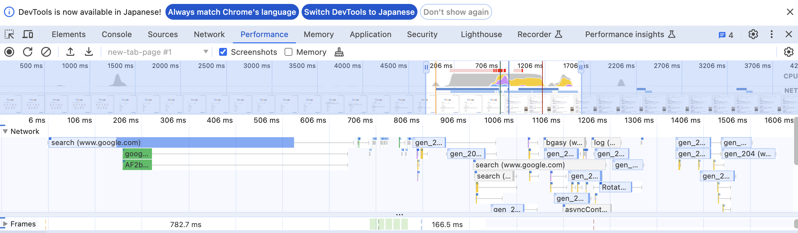

### 継続的プロファイリング

継続的プロファイリングでは、低オーバーヘッドのサンプリングを使用して本番環境でも安全に実行でき、長期にわたってプロファイルを収集・分析できます。分散システム全体の動作把握に特に有効です。
継続的プロファイリングでは、オーバヘッドの低いサンプリングを使用して、プロファイルを安全に収集します。そのプロファイルはデータベースに保存するため、後で分析できます。

継続的プロファイリングを使用すると、分散サービス化しているアプリケーションが、本番環境でどのように動作するかを、全体的に把握することにも役立ちます。


## Pyroscopeについて


**Pyroscope**は、Grafana Labsにより展開されている、継続的プロファイリングのOSS製品です。

元々、Grafana Phlare というプロジェクトがありましたが、2023/3 に、Grafana LabsがPyroscope社を買収し、Grafana Phlare と Pyroscope が統合され「Grafana Pyroscope」となりました。
2023/9 に v1.0.0 がリリースされています。

### Write（プロファイルの書き込み）

1. distributorがプロファイルを受け取り、segment-writerへ転送します。
2. segment-writerがプロファイルをオブジェクトストレージへ書き込みます。
3. metastoreがデータの場所を管理し、compaction-workerが保存されたデータを圧縮します。


### Read（プロファイルの読み込み）

1. query-frontendがクエリを受け取ります。
2. metastoreから対象データの場所を取得します。
3. query-backendがオブジェクトストレージからデータを読み出し、結果を返します。

詳細は[Pyroscope v2 architecture](https://grafana.com/docs/pyroscope/latest/reference-pyroscope-v2-architecture/)を参照してください。

## Pyroscopeへのプロファイルの送信（クライアント）
プロファイルをPyroscopeに送信するには、各言語向けのPyroscope SDK、Grafana Alloy、OpenTelemetry eBPF Profilerなどを利用できます。

本章では、PyroscopeのHelm Chartに付属するAlloyによる自己プロファイリングに加え、**OpenTelemetry Collector**でハンズオンアプリのCPUプロファイルを収集します。アプリケーションのコード変更やSDKの追加は不要です。

> [!NOTE]
> Grafana AgentはEOLとなっており、Grafana Alloyへ移行されています。

## 実践: Grafana Pyroscopeのインストール
実践として、Pyroscopeをインストールします。以降のハンズオンででは、pyroscopeのchapterを作業ディレクトリとしてください。
```bash
cd ~/cnd-handson/chapter_pyroscope
```

Kubernetesクラスタ上にPyroscopeをインストールします。
ここでは、grafanaのHelm Chartから利用します。

Pyroscopeでは、モノリシックモードと、マイクロサービスモードという、2つのデプロイ方式が選択できます。本章ではv2ストレージアーキテクチャのマイクロサービスモードを採用します。

用意されているhelmfile.yamlおよび `helm/values-micro-services.yaml` を利用して、 `helmfile sync` を実行し、Pyroscopeをインストールしましょう。

```bash
helmfile sync -f helm/helmfile.yaml
```

Pyroscopeのプロファイルデータは、同時に導入されるS3互換ストレージのSeaweedFSに保存します。
認証情報はローカルハンズオン専用の固定値として自動設定されるため入力不要ですが、本番環境では使用しないでください。

実際に各種サービスが起動しているか確認します。

```bash
kubectl get pods -n monitoring -l app.kubernetes.io/instance=pyroscope
```

```text
# 実行結果（マイクロサービスモード）
pyroscope-admin-xxxxxxxxxx-xxxxx              1/1     Running
pyroscope-alloy-0                             2/2     Running
pyroscope-compaction-worker-0                 1/1     Running
pyroscope-compaction-worker-1                 1/1     Running
pyroscope-distributor-xxxxxxxxxx-xxxxx        1/1     Running
pyroscope-metastore-0                         1/1     Running
pyroscope-query-backend-xxxxxxxxxx-xxxxx      1/1     Running
pyroscope-query-backend-xxxxxxxxxx-xxxxx      1/1     Running
pyroscope-query-backend-xxxxxxxxxx-xxxxx      1/1     Running
pyroscope-query-frontend-xxxxxxxxxx-xxxxx     1/1     Running
pyroscope-segment-writer-0                    1/1     Running
pyroscope-segment-writer-1                    1/1     Running
```


## Pyroscopeフロントエンドへのアクセス
Pyoscopeの画面にアクセスします。pyroscopeの画面を参照するために、HTTPRouteリソースを追加します。

```bash
kubectl apply -f httproute.yaml
```

[http://pyroscope.example.com](http://pyroscope.example.com)にアクセスしましょう。すでにPyroscope自身のプロファイルが確認できます。

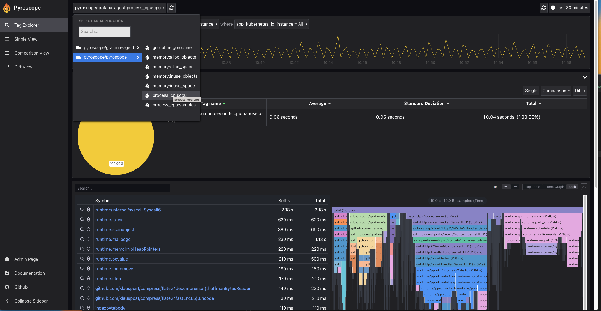


## Grafanaへのデータソース追加
chapter_grafanaで構築したGrafanaに、Pyroscopeのデータソースを追加します。
* Data sourse：Grafana Pyroscope
* HTTP>URL：http://pyroscope-query-frontend.monitoring.svc.cluster.local:4040

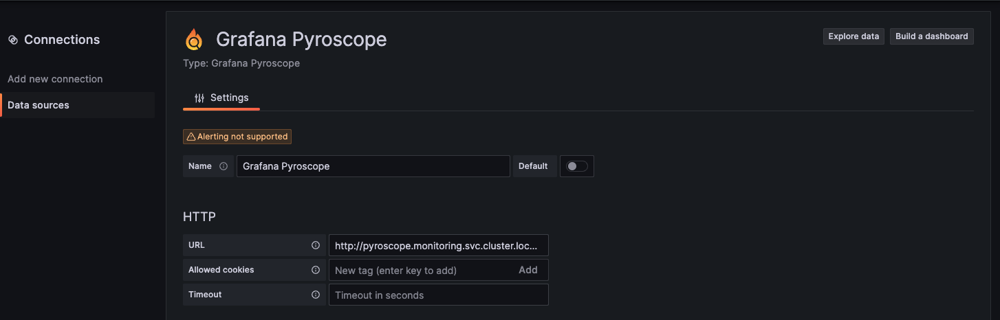

※kube-prometheus-stackで使用したhelmのvaluesに追加する手順でも対応できます。
```yaml
datasources:
  - name: Grafana Pyroscope
    type: grafana-pyroscope-datasource
    url: http://pyroscope-query-frontend.monitoring.svc.cluster.local:4040
```

## Grafanaからのプロファイル参照
GrafanaのExplore([http://grafana.example.com/explore](http://grafana.example.com/explore))からプロファイルを見てみましょう。GarafanaのExploreでは、プロファイルタイプの選択と、ラベルセレクターでの絞り込みで、容易に表示できます。

プロファイルタイプは、cpu、memory、goroutineなどがあり、各言語ごとにサポートされています。詳細は、[Pyroscopeのドキュメント](https://grafana.com/docs/pyroscope/latest/view-and-analyze-profile-data/profiling-types/#available-profiling-types)を参照ください。

ラベルセレクターは、対象をtagで絞りたい場合に有効です。これは、Pyroscopeのclient側で付与されたtagになります。PyroscopeのHelm Chartに付属するAlloyでは、収集対象を識別するラベルが付与されています。（[Pyroscope](http://pyroscope.example.com)のSingle View>Select Tagでの確認が簡単です。）空欄のままでもプロファイルを参照可能です。

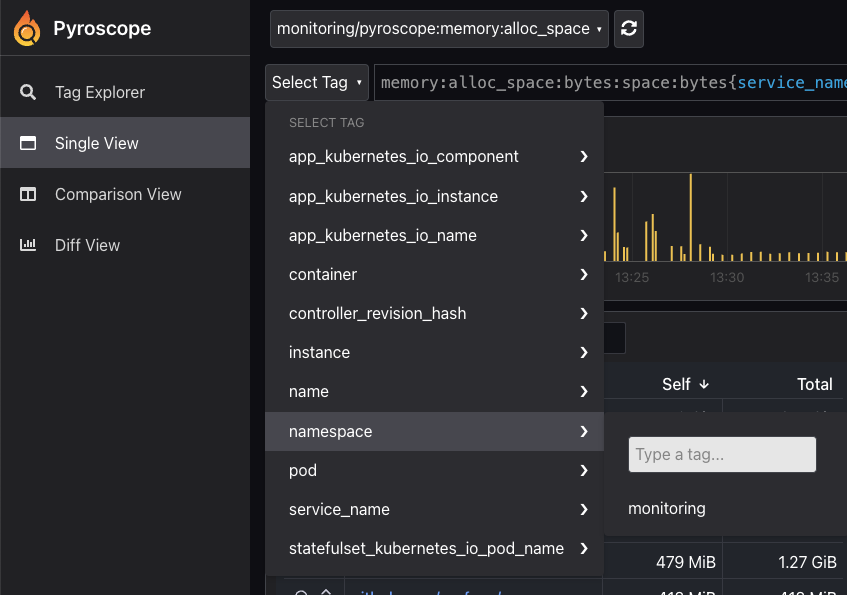


1. プロファイルタイプを選択します。試しに、`process_cpu-cpu`を選択します。

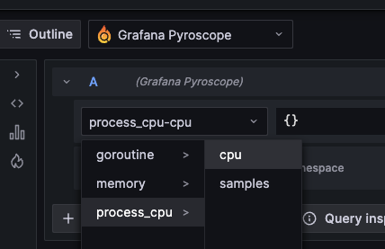

2. ラベルセレクターで、対象を絞り込みます。記法は`{<tag>=<value>}`です。 試しに、`{app_kubernetes_io_instance="pyroscope"}`を入力します。

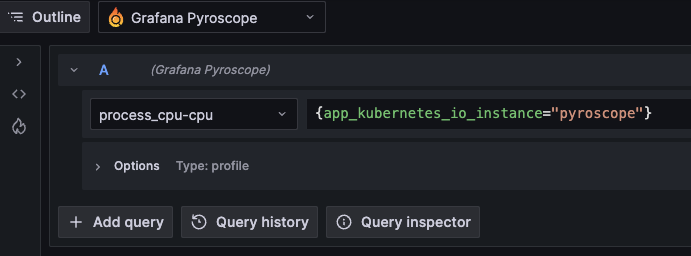

3. 「Run query」を実行して、プロファイルを表示します。

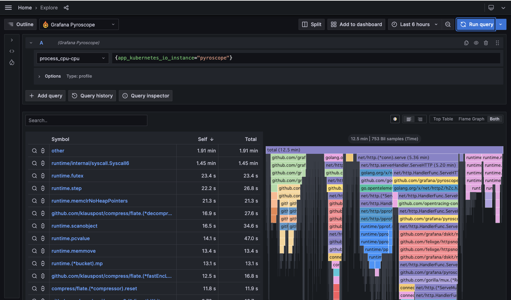


1. メトリクスも同時に表示できます。「Options」で表示項目を増やし、「Query Type」を「Both」にします。

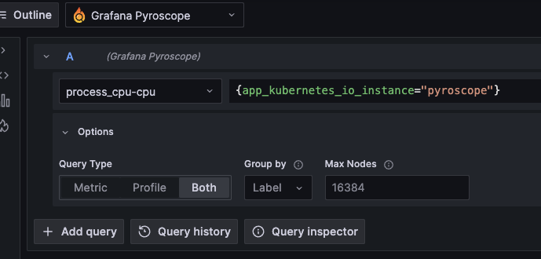

5. 再度、「Run query」を実行すれば、メトリクスとプロファイルを同時に表示できます。（※「Query Type」を「Metric」にすれば、メトリクスだけ表示します）

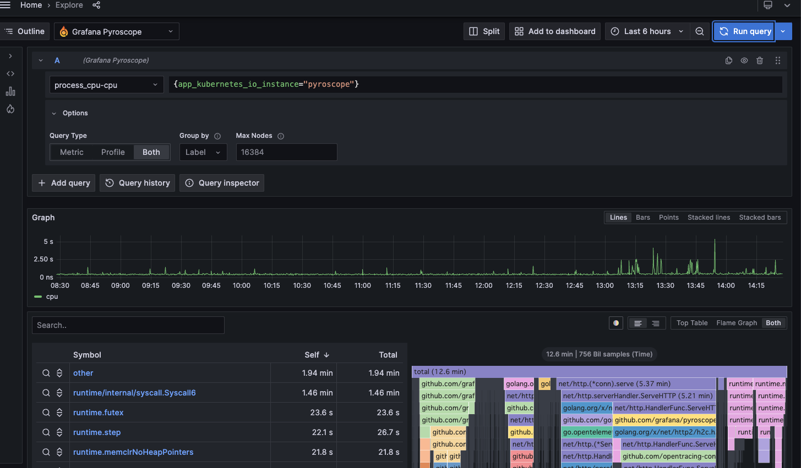

## 実践: OpenTelemetry Collectorでアプリケーションをプロファイリングする

ここまではPyroscope自身のプロファイルを参照しました。次に、クラスター作成章でデプロイしたGoアプリケーション `handson-blue` のCPUプロファイルを収集します。

[OpenTelemetry章](../chapter_opentelemetry/README.md)で学んだReceiver → Processor → Exporterのパイプラインを、`profiles` シグナルにも適用します。

```text
各ノードのプロセス
  → profiling Receiver（eBPFでCPUスタックをサンプリング）
  → k8s_attributes / transform Processor（Pod情報・サービス名を付与）
  → OTLP Exporter（gRPC）
  → Pyroscope distributor:4040
  → Pyroscope / Grafanaで参照
```

OpenTelemetry eBPF Profilerは、`profiling` Receiverを組み込んだ専用のCollectorディストリビューションです。OpenTelemetry章の通常の `opentelemetry-collector-contrib` イメージにはこのReceiverが含まれないため、この実習のCollectorだけ専用イメージを指定します。既存のログ・メトリクス・トレース用Collectorは変更しません。

| 仕組み | このハンズオンでの役割 |
| --- | --- |
| OpenTelemetry章のGo自動計装（`Instrumentation`） | Goアプリのトレースを取得する |
| OpenTelemetry eBPF Instrumentation（OBI） | コード変更なしでトレースやメトリクスを取得する。本実習では導入しない |
| OpenTelemetry eBPF Profiler | CPUプロファイルを取得し、Collectorのprofilesパイプラインへ渡す |

eBPFを使う仕組みでも、それぞれ役割が異なります。本実習ではトレースとの関連付けは行いません。また、この方法で収集するのはCPUプロファイルです。前節で紹介したメモリやgoroutineなどのプロファイルには、SDK等の対応する収集方法が必要です。

### 前提の確認

[OpenTelemetry章のセットアップ](../chapter_opentelemetry/README.md#セットアップ)でOpenTelemetry Operatorをインストールしておいてください。Jaegerやトレース用Collectorの起動は、この実習の必須条件ではありません。

```bash
cd ~/cnd-handson/chapter_pyroscope
kubectl -n monitoring rollout status deployment/opentelemetry-operator --timeout=120s
kubectl explain opentelemetrycollector.spec.hostPID
kubectl -n handson rollout status deployment/handson-blue --timeout=120s
kubectl -n monitoring get service pyroscope-distributor
```

> [!NOTE]
> eBPF Profilerは、各kubernetesノード上で動くアプリケーションのCPUプロファイルを収集します。Linuxカーネルの機能を使ってプロセスを調べるため、この実習ではCollectorを特権付きのPodとして実行します。

### プロファイル用Collectorの導入

[manifests/profiles-collector.yaml](./manifests/profiles-collector.yaml)には、ServiceAccount、読み取り用RBAC、`OpenTelemetryCollector` を用意しています。Operatorが各ノードにCollectorをDaemonSetとして配置します。

> [!NOTE]
> 本ハンズオンでは、kindでクラスタを組んでおり、ノード自体がコンテナのため、`pid_namespace_translation_mode: auto` で入れ子になっているPID namespaceを変換します（[参考](https://github.com/open-telemetry/opentelemetry-ebpf-profiler/pull/1801)）。これがないとアプリのプロセスを正しく識別できません。

`hostPID: true` とホストの `/proc`・`/sys/kernel`・`/sys/fs/cgroup` のマウントによりノード上のプロセスを参照し、root・privilegedでeBPFを使用します。これはローカルハンズオン用の設定です。

```bash
kubectl apply -f manifests/profiles-collector.yaml
kubectl -n monitoring wait --for=create daemonset/profiles-collector-collector --timeout=60s
kubectl -n monitoring rollout status daemonset/profiles-collector-collector --timeout=180s
kubectl -n monitoring get opentelemetrycollector profiles-collector
kubectl -n monitoring logs -l app.kubernetes.io/name=profiles-collector-collector --tail=30
```

`spec.config.service.pipelines.profiles` では、`profiling` Receiverの出力に、`container.id` を使ってPod情報を関連付けます。Deployment名を `service.name` に設定し、Deploymentに属さないプロセスは実行ファイル名をサービス名に使います。送信先は読み取り用のquery-frontendではなく、書き込み用の `pyroscope-distributor.monitoring.svc.cluster.local:4040` です。

> [!NOTE]
> Collectorはノード全体のCPUプロファイルを収集します。`k8s_attributes.filter.node_from_env_var` はPod情報の取得範囲を同じノードに限定する設定であり、プロファイルの収集対象を限定する設定ではありません。ハンズオンアプリへの絞り込みは、次の手順で画面上から行います。

### アプリケーションに負荷をかける

アイドル状態ではCPUサンプルが少ないため、`handson-blue` のPodに2分間HTTPリクエストを送り続けます。既存のServiceはblueとyellowの両方を選択するので、ここではblueのPod IPを指定します。

```bash
HANDSON_BLUE_IP=$(kubectl -n handson get pods -l app=handson,color=blue -o jsonpath='{.items[0].status.podIP}')
kubectl -n handson run profiles-load \
  --image=busybox:1.37.0 --restart=Never \
  --env="TARGET_URL=http://${HANDSON_BLUE_IP}:8080/" \
  --overrides='{"spec":{"activeDeadlineSeconds":300}}' \
  -- sh -c '
    end=$(( $(date +%s) + 120 ))
    pids=""
    for worker in 1 2 3 4; do
      (
        while [ "$(date +%s)" -lt "$end" ]; do
          wget -q -T 5 -O /dev/null "$TARGET_URL" || exit 1
        done
      ) &
      pids="$pids $!"
    done
    for pid in $pids; do
      wait "$pid" || exit 1
    done
  '
kubectl -n handson wait --for=condition=Ready pod/profiles-load --timeout=120s
kubectl -n handson logs -f profiles-load
kubectl -n handson get pod profiles-load
```

正常時には負荷生成Podのログは空です。Podが `Completed` になったことを確認します。もう一度実行する場合は、先に `kubectl -n handson delete pod profiles-load` で削除してください。アプリのPodが再作成された場合は、Pod IPも取得し直します。

### アプリケーションのフレームグラフを確認する

収集・転送後、表示まで数分待ちます。[Pyroscope](http://pyroscope.example.com)で直近15分を選び、サービス名 `handson-blue` とCPUプロファイル（`process_cpu:cpu:nanoseconds:cpu:nanoseconds`）を選択します。GrafanaのExploreでもPyroscopeデータソースから同じサービスを選択できます。

Pyroscopeでは、サービス名 `handson-blue` を選ぶと、次のようにアプリケーションのCPUプロファイルを確認できます。

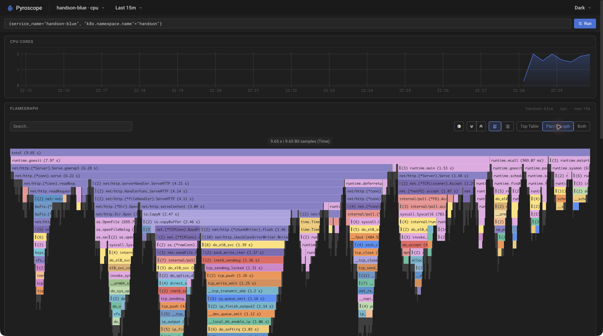

`service_name` ラベルには `service.name` が反映されるため、ラベルセレクターは次のように指定できます。

```text
{service_name="handson-blue", "k8s.namespace.name"="handson"}
```

`k8s.namespace.name` のようにドットを含む属性名は、上記のようにダブルクォートで囲みます。

Pod名やnamespaceのラベルも確認し、`handson` namespaceのblue Podのデータであることを確かめます。既存の自己プロファイルと今回のアプリのプロファイルは、サービス名で区別できます。

GrafanaのExploreでも、同じサービス名とnamespaceで絞り込んだフレームグラフを表示できます。「Options」の「Query Type」を「Profile」にし、グラフ右上の「Flame Graph」を選ぶと、フレームグラフを大きく表示できます。以下は負荷をかけた `handson-blue` の実際の取得例です。

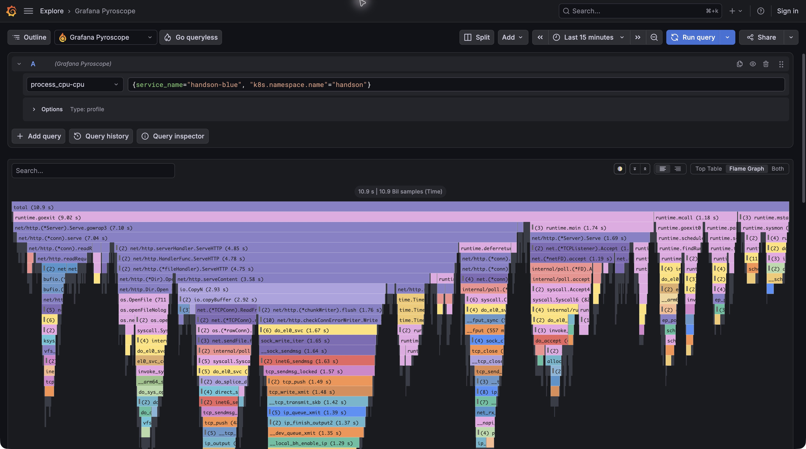

フレームグラフの横幅は、その関数と呼び出し先で観測されたCPUサンプルの割合を表します。横軸は、負荷が大きい処理から順にスタックされて表現されます。`main` パッケージのHTTP処理や、そこから呼ばれるGoランタイム・標準ライブラリの関数を眺めてみましょう。表示される関数と割合は負荷や環境によって変わります。


### 後片付け

```bash
kubectl -n handson delete pod profiles-load --ignore-not-found
kubectl delete -f manifests/profiles-collector.yaml
```

この実習用のCollectorとRBACだけを削除します。Pyroscope・Operator・既存のアプリや他のCollectorは引き続き利用できます。

## プロファイルの比較によるアプリケーションの改善
プロファイルは、ラベルセットや期間で比較することができ、パフォーマンスの変化を可視化できます。
たとえば、あるリリースからメモリリークが発生するようになり、プロファイルを比較することで原因の関数を特定するなど、アプリケーションの改善に役立ちます。

[http://pyroscope.example.com](http://pyroscope.example.com/) の`Comparison View`から、`Baseline time range`で比較元の期間、`Comparison time range`で比較先の期間を選択すると、比較結果が表示されます。

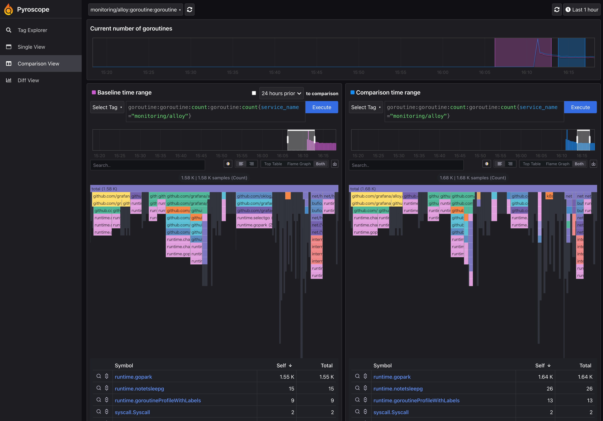


`Diff View`は上の`Comparison View`を拡張したもので、2つのプロファイルの差分を見ることができます。各関数が費やした時間を比較できるため、たとえばパフォーマンスの劣化や改善を認識できます。

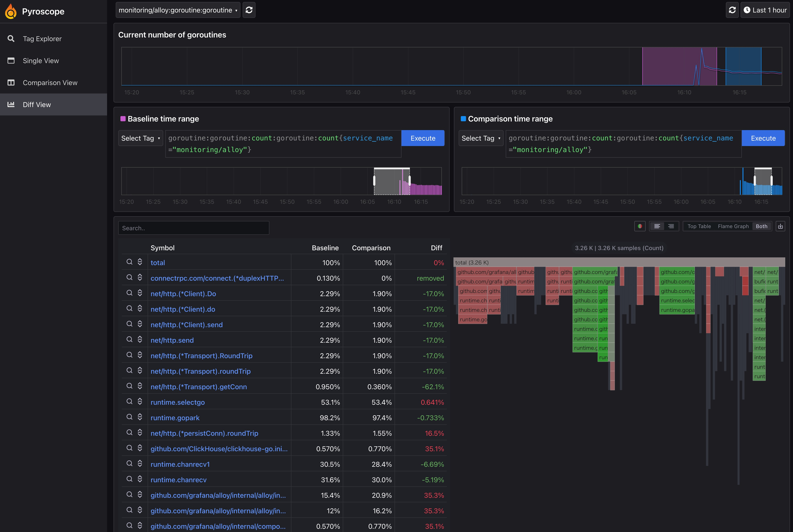


## まとめ
当ハンズオンでは、プロファイルとは何かという原理・原則的な話から、実際にGrafanaLabsのPyroscopeを使ったプロファイリングの実装を、手短に説明してみました。プロファイルは、アプリケーションのどのプログラムがパフォーマンスに影響しているかを、一発で見つけることに貢献します。また、メトリクスはもちろん、トレース、ログとの紐付けなども期待できますので、ぜひ実装にチャレンジしてみてください。

## 参考: モノリシックモードで動かす場合
本章はマイクロサービスモードを前提としますが、参考としてモノリシックモードの手順も記載します。

1) `helm/helmfile.yaml` の `values` を一時的にコメントアウトし、`values-micro-services.yaml` を無効化します。
```yaml
releases:
- name: pyroscope
  namespace: monitoring
  createNamespace: true
  chart: grafana/pyroscope
  version: 2.4.3
  # values:
  # - values-micro-services.yaml
```

2) 再デプロイします。
```bash
helmfile sync -f helm/helmfile.yaml
```

3) HTTPRoute のバックエンドServiceを `pyroscope` に変えます（`httproute.yaml`）。
```yaml
    backendRefs:
    # - name: pyroscope-query-frontend # マイクロサービスモードで指定するservice名
    - name: pyroscope # モノリシックモードの場合はこちらに変更
      port: 4040
```

4) Pod例（モノリシック）：
```text
pyroscope-0         1/1     Running   0          22s
pyroscope-alloy-0   2/2     Running   0          22s
```

5) Grafana のデータソースURL例（モノリシック）：
```text
http://pyroscope.monitoring.svc.cluster.local:4040
```

## 参考文献

- [Pyroscopeの公式ドキュメント](https://grafana.com/docs/pyroscope/latest/)
- [OpenTelemetry eBPF ProfilerからPyroscopeへの送信](https://grafana.com/docs/pyroscope/latest/configure-client/opentelemetry/ebpf-profiler/)
- [OpenTelemetry eBPF Profiler](https://github.com/open-telemetry/opentelemetry-ebpf-profiler)
- [What is continuous profiling, and what is Pyroscope?](https://isitobservable.io/open-telemetry/what-is-continuous-profiling-and-what-is-pyroscope)
