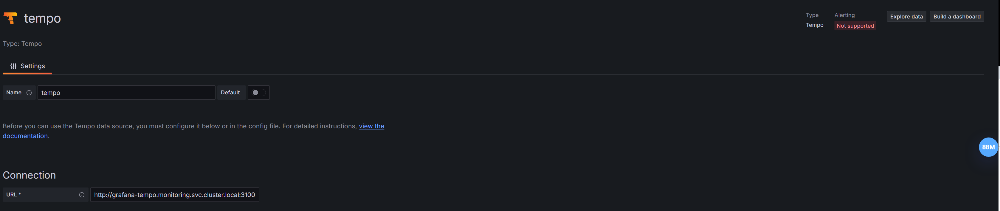
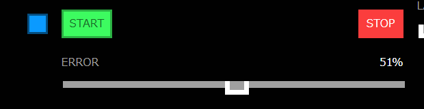
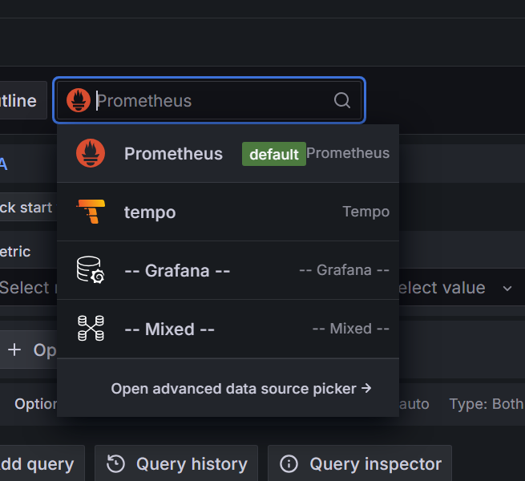
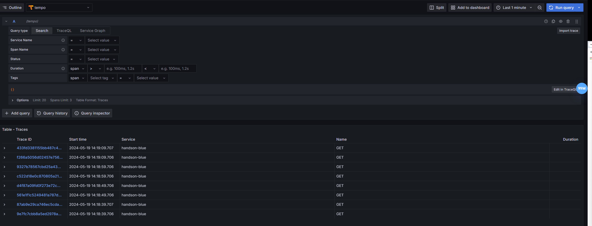
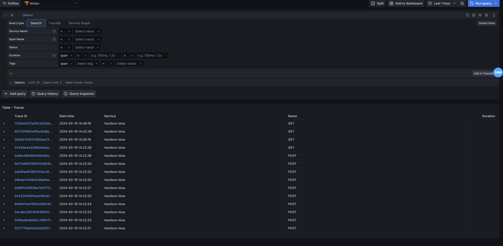
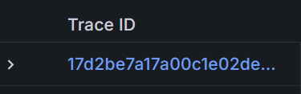
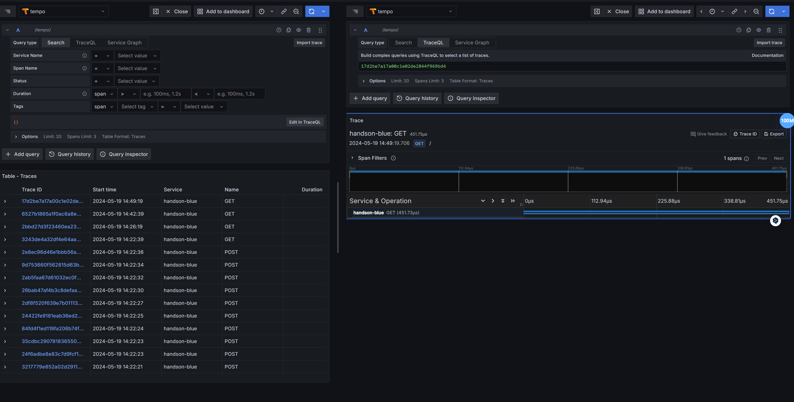
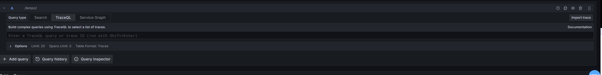
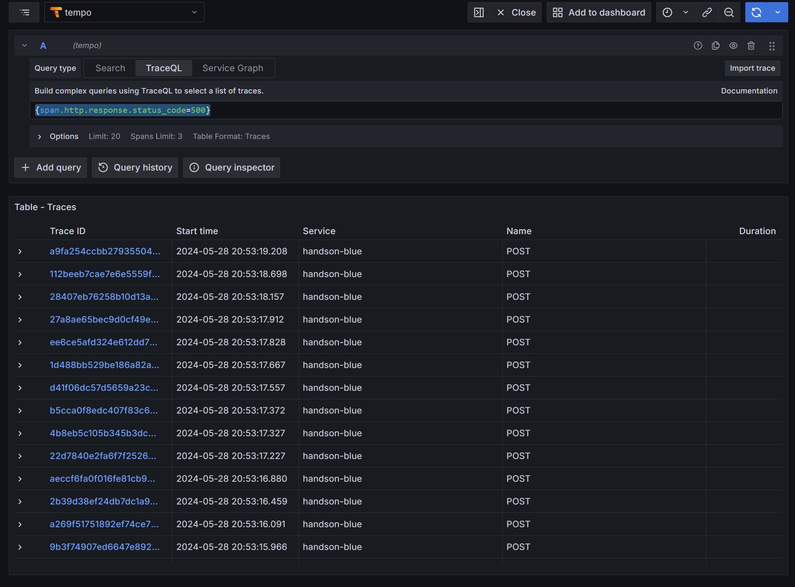

# Grafana Tempo
## 概要
[Grafana Tempo](https://github.com/grafana/tempo)は[GrafanaLab](https://github.com/grafana)が開発をしているOSSで、大規模な分散トレース バックエンドです。
Tempoを利用するとトレースを検索し、スパンからメトリクスを生成し、トレーシングデータをログとメトリクスにリンクすることができます。
動作にはオブジェクト ストレージのみが必要で、[Grafana](https://github.com/grafana/grafana)、[Prometheus](https://github.com/prometheus/prometheus)、[Loki](https://github.com/grafana/loki) などと連携することができます。


TempoはJaeger、OpenTelemetry と互換性があります。Azure、GCS、S3、またはローカル ディスクに書き込みます。

Tempo は、LogQL と PromQL からインスピレーションを得たトレースファーストのクエリ言語であるTraceQLを実装しています。このクエリ言語を使用すると、ユーザーは非常に正確かつ簡単にスパンを選択し、指定された条件を満たすスパンに直接ジャンプできます。

## アーキテクチャ

Tempo 3では、書き込みと読み込みを分離したアーキテクチャを採用しています。本章で使用するモノリシックモードでは、以下のコンポーネントが1つのプロセス内で動作します。

- Distributor: OpenTelemetryなどの形式でスパンを受信します。
- Live-store: 受信直後のトレースを検索可能にし、ブロックをオブジェクトストレージへ保存します。
- Query frontend / Querier: クエリを分割し、live-storeとオブジェクトストレージからトレースを検索します。
- Backend scheduler / worker: ブロックの圧縮、保持期間、ブロック一覧を管理します。
- Metrics-generator: トレースからメトリクスを生成し、Prometheusへ送信します。

詳細は[Tempo architecture](https://grafana.com/docs/tempo/latest/introduction/architecture/)を参照してください。

## デプロイ方法
Tempo は、モノリシック モードまたはマイクロサービスモードでデプロイできます。

### モノリシックモード
- モノリシック モードでは、すべてのコンポーネントが 1 つのプロセスで実行され、Tempo のインスタンスが形成されます。
- モノリシック モードは展開が最も簡単ですが、コンポーネントの量を増やして水平方向にスケールアウトすることはできません。
- 今回のハンズオンではこちらを利用しています。

### マイクロサービスモード
- マイクロサービス モードではコンポーネントは個別のプロセスにデプロイされます。
- Kafka互換のキューを利用し、書き込み経路を永続化します。
- スケーリングはコンポーネントごとに行われるため、スケーリングの柔軟性が向上しより詳細に設定できるようになります。
- これはProduction環境で推奨される方法ですが、最も複雑でもあります。

## Trace QLの概要
TraceQL は、PromQL と LogQL からインスピレーションを得て、Tempo でトレースを選択するために設計されたクエリ言語です。現在、TraceQL クエリは以下に基づいてトレースを選択できます。
- スパンとリソースの属性、タイミング、期間
- 基本的な集計: count()、avg()、min()、max()、およびsum()
TraceQL の設計の詳細については、[TraceQL コンセプトの設計提案](https://github.com/grafana/tempo/blob/main/docs/design-proposals/2022-04%20TraceQL%20Concepts.md)を参照してください。

## セットアップ
この章を行うにはPrometheusとGrafanaとOpentelemetryをデプロイしておく必要があります。
各章へ行きデプロイしてきてください。
`helmfile sync` を実行し Tempoをデプロイします。
```bash
cd ~/cnd-handson/chapter_tempo
helmfile sync -f helm/helmfile.yaml
```

Tempoのトレースデータは、同時に導入されるS3互換ストレージのSeaweedFSに保存します。
認証情報はローカルハンズオン専用の固定値として自動設定されるため入力不要ですが、本番環境では使用しないでください。

デプロイが完了したら起動しているかどうかを確認してください。
```bash
kubectl get pod -n monitoring
```

```text
NAME                                      READY   STATUS    RESTARTS   AGE
grafana-tempo-0                           1/1     Running   0          102s
opentelemetry-operator-569f6b668c-zrzdb   2/2     Running   0          23h
```
デプロイが完了したら次にGrafanaにTempoを追加する設定を行います。
`http://grafana.example.com/connections/datasources`にアクセスしAdd data sourceをクリックしてください。
下のほうへスクロールするとTempoが存在するのでクリックします。
設定画面に遷移するので`Connection`の`URL`欄に`http://grafana-tempo.monitoring.svc.cluster.local:3200`を入力して一番下にあるSave & testをクリックしてください。

`Data source successfully connected.`と表示されると設定が完了しています。
今回はGUIで設定しましたが`prometheus/helm/prometheus-valus.yaml`に設定を追加することでコード上で設定を追加することも可能です。

次にOpenTelemetryの設定をApplyします。

```bash
kubectl apply -f manifests/
```

OpenTelemetryの章ではJaegerに向けていた設定をTempoへ書き換えています。
自動インスツルメンテーションを利用するためにhandson-blue Deploymentに対しても設定を行います。kubectl patchコマンドを利用してこれらのアノテーションを付与します。

```bash
kubectl -n handson patch deployment handson-blue -p '{"spec":{"template":{"metadata":{"annotations":{"instrumentation.opentelemetry.io/inject-go": "go-instrumentation"}}}}}'
kubectl -n handson patch deployment handson-blue -p '{"spec":{"template":{"metadata":{"annotations":{"instrumentation.opentelemetry.io/otel-go-auto-target-exe": "/rollouts-demo"}}}}}'
```

これでセットアップは完了です。
## search
まず`http://app.example.com/`にアクセス後Errorのバーをスライドしてエラーを出力します。

次に`http://grafana.example.com/explore`を開きます。
Promethusと書かれてるトグルメニューをクリックしてください。するとメニューが展開されるのでTempoを選択します。



Run Queryボタンをクリックしてください。



すると一覧が表示されます。


一覧の中から1つTrace IDを選択してクリックしてください。



右にTrace IDの詳細が展開されます。この画面はTrace IDを直接 Trace QLの欄に記入しても開くことができます。


## TraceQL
次にTrace QLタブをクリックしてください。


空欄があるので`{span.http.response.status_code=500}` と入力してみましょう。
すると表示されます。


## おまけ
今回は時間の都合上省略しますがLokiと連携してTraceとLogを接続する方法やPrometheusと連携してTraceとMetricsを連携する方法、
Pyroscopeと連携してTraceとprofilesを連携する方法があります。
Tempoを深く知るためにこちらもぜひ挑戦してみてください。
